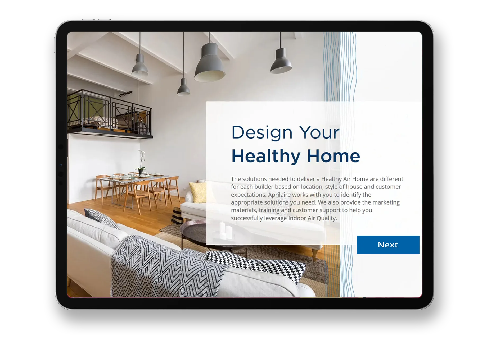
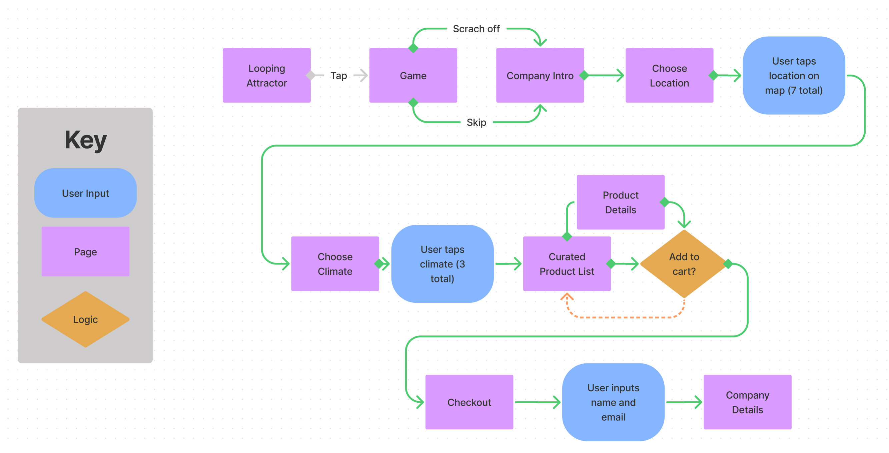
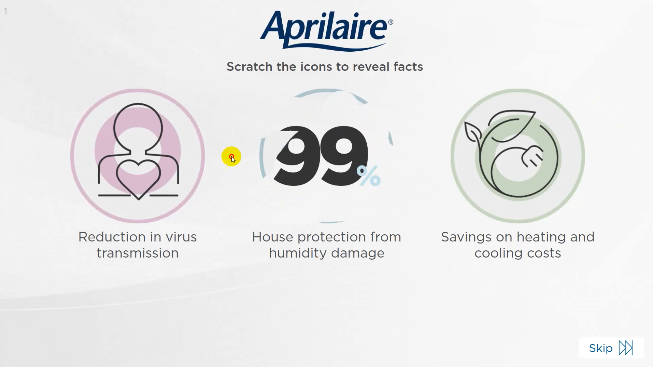
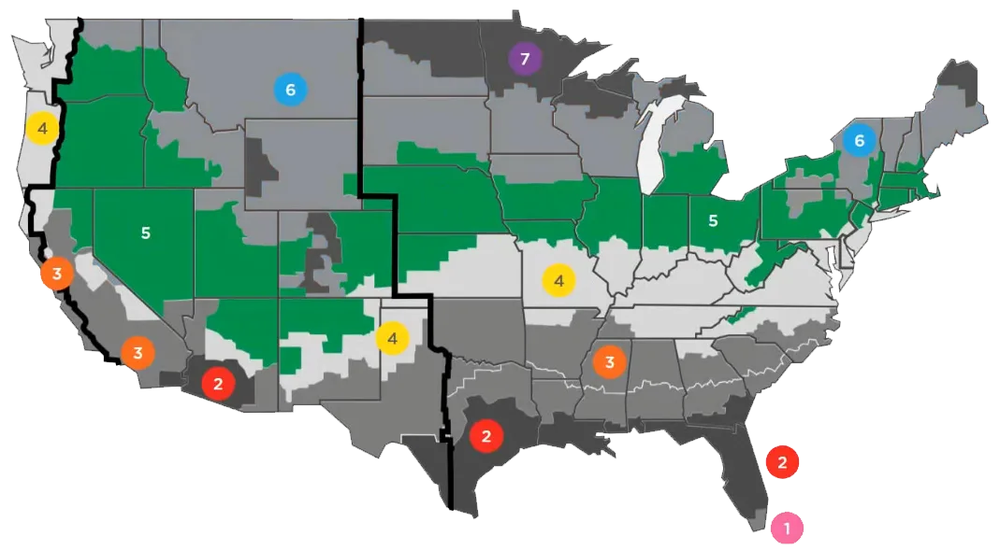
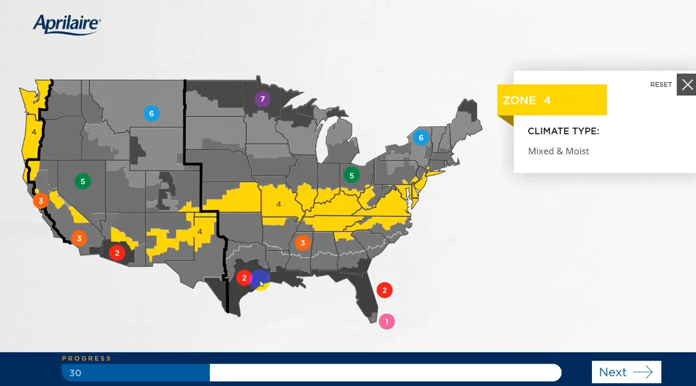
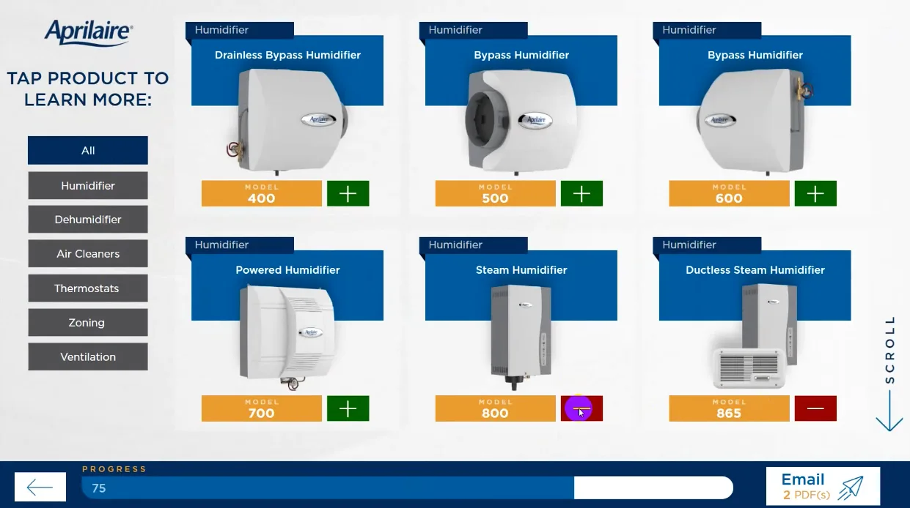

Aprilaire needs an attractive and easy-to-use app to pair customers with their vast array of products as well as inform their team of the potential sale.

## The challenge

AprilAire had a trusted product but lacked a digital presence that resonated with modern homeowners and professionals.

- Outdated design that didn’t reflect product quality
- Confusing site architecture made it hard to find information
- No clear brand story or emotional connection

### Our approach

We modernized AprilAire’s digital experience to match its reputation and drive user trust.

- Refreshed the brand with a clean, health-focused aesthetic
- Reorganized site structure for easier navigation and discovery
- Clarified messaging to connect with both homeowners and pros

user journey mapping

## The product you need, curated at your fingertip

1. Customer opens app to learn which product best fits their needs
2. The customer chooses their geographical location
3. The customer chooses the climate in their region
4. Products are shown based on the inputs from 2 and 3
5. Product is chosen and added to cart
6. Customer clocks checkout
7. Customer fills in contact information
8. Contact information is sent to online database for sales lead

Aprilaire produces machines to turn air clean. They specialize in humidifiers, dehumidifiers, air filters, and more.

## Goals

### Education

The customer will learn which products are offered directly correlating to region and climate.

### Leads

A qualified lead is gathered with key sales information of exactly which product is needed.

The app should be based on visuals and simple layouts to gamify and not overwhelm the user. We will include a progress bar to not intimate the user and provide a visual end goal to their user journey.

### Gamification

The home screen features a scratch-off type game to lure users into discovering facts. After all of the numbers are revealed it is programmed to progress to the next slide that features a simple explanation of Aprilaire.

## Geography & Filtering

The apps key feature revolves in it having a customized experience based on region. One of the first things is to choose which area the customer is going to utilize the product. Instead of a dropdown and text-based selection, I chose to have a visual map. Once an area is clicked it changes to show that region.

### Geographical Plotting

The backend consists of an excel database linked to specific products. All products are live in the background. As the user progresses through the initial forms the database is reordered and hides products that would not be applicable to their geographic region. This narrows down the choices and provides a cleaner and easier product exploration page

## Products & Cart

Now that the customer has gone through the process of selecting their environment the customized product page is shown. You can view more details once you tap the product of your choosing.

### Product Selection

Adding the products to your cart will add them into a database while browsing. After the user fills in their email information it links their contact to the items they are interested in. Upon completion, it brings them to a more detailed page explaining Aprilaire.

## Data & ROI

The database is connected to an online API emailer that will send an email to the client with the potential customer's name and products chosen. A sales representative can reach out to the customer and walk through the products, what they offer and how they can benefit their house or construction project.

## A vision realized

### Conclusion

The Aprilaire Interactive Product Selector turned a large, technical product catalog into a guided experience anyone can finish in a few taps. Customers start with something they already know, where they live and what their climate is like, and the app does the narrowing for them, surfacing only the humidifiers, dehumidifiers, and air filters that fit their home. A playful scratch-off intro and a visible progress bar keep the experience light, while every completed session hands the Aprilaire sales team a qualified lead that already knows which products it needs.

### Key outcomes

#### Clearer product discovery

Region and climate filtering replaced endless scrolling, so customers see a short, relevant list instead of the entire catalog.

#### Sales-ready leads

Each submission pairs contact details with the exact products chosen and sends them straight to the sales team, so follow-up conversations start from real interest.

#### An approachable brand experience

Visual, game-like interactions made a technical category feel simple and friendly, reinforcing Aprilaire's reputation for healthy, comfortable homes.

In collaboration with:

-   Client acquisition and production: [Multi Image Group](https://www.mig.cc)
