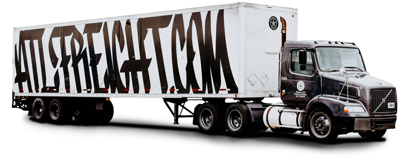
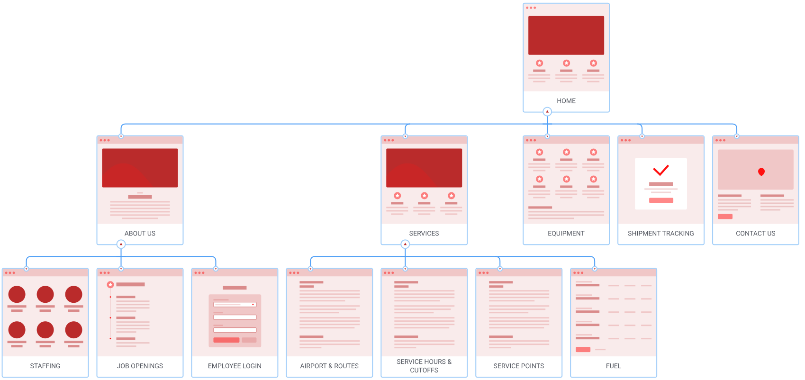
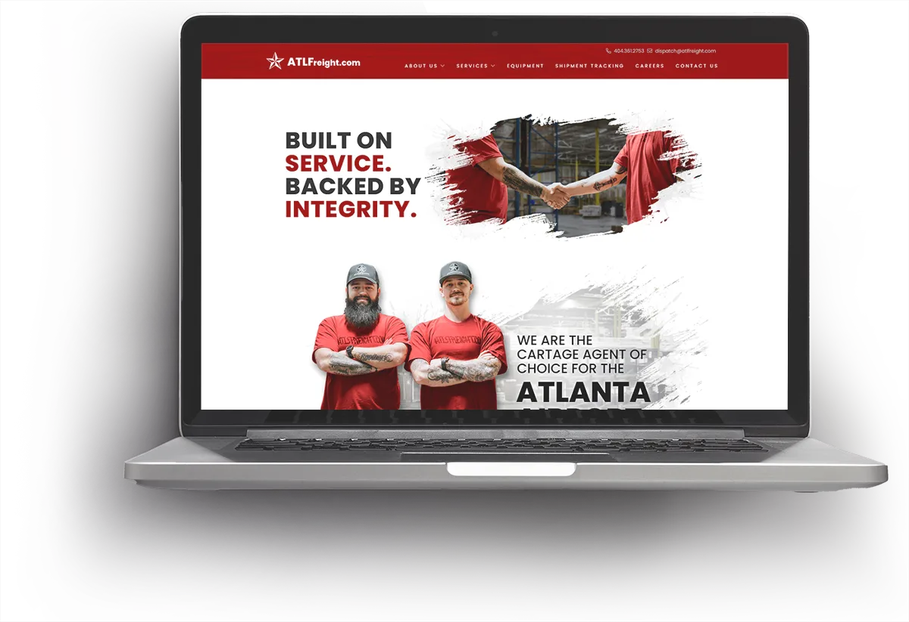
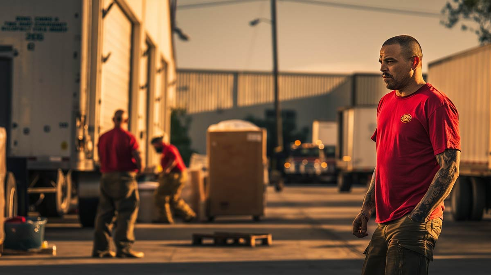
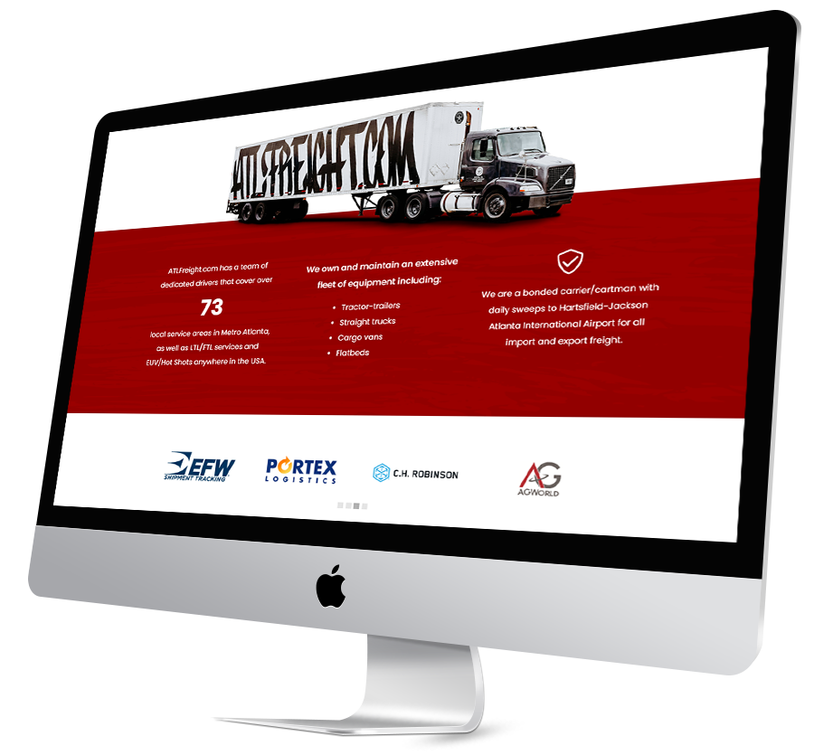

Built on service, backed by integrity.

## The challenge

ATL Freight was scaling quickly, but their website didn’t reflect the sophistication or reliability of their operations.

- Dated design that undercut trust with enterprise clients
- Messaging didn’t communicate key differentiators
- No clear path for lead generation or inquiries

### Our approach

We rebuilt the ATL Freight site to position them as a modern, logistics-first partner.

- Crafted a bold, professional brand identity
- Simplified messaging to highlight ATL’s core strengths
- Designed a clear conversion funnel to support sales

user journey mapping

## Clean and simple UX, let the pictures do the talking.

One of the east coast’s premier freight companies with a talented and hard-working staff.

## Unique & Bold

### Homepage

The homepage needs to show the ethos of the company so we decided to use a big tagline. The grunge look was used to tie the entire site together.

We designed it to be a cut-out in order to keep as much white space as possible. This allowed the sharp lines and color contrast to draw the eye. The site was meant to be unique among the freight industry, breaking the norms and really showing the culture of ATLFreight.com

### Callouts & Page Breaks

Part of the website needed more direct attention, mostly pertaining to important numbers or other services that made them stand apart from the competition. For these areas, we programed a parallax red background.

### Grunge & animations

We made a grunge look into a slightly opaque PNG and set that over the red background., When scrolling the PNG would shift slightly on the vertical axis which gave the site a subtle animation effect.

We programmed an animating carousel for the client logos as well as the testimonials. These simple animations give the homepage a customized look and bring this site up to date.

## A look you wanna rock.

### Conclusion

Working with the wonderful ATLFreight team and the fantastic Nancy Trowbridge, who did a lot of work as the producer, we met all of the goals and everyone was happy with the end result. The website got many compliments from team members as well as their clientele.

The photographer, Kandace Ventura, really pulled the site together with absolutely stunning imagery.

In collaboration with:

-   Client acquisition: [Nancy Trowbridge](https://www.linkedin.com/in/nancytrowbridge/)
-   Photographer: Kandace Ventura

### Key outcomes

#### A unique style

ATLFreight wanted the site to showcase that they are far from cookie-cutter. Their employees are themselves and they want to keep it that way while showing the world who they are.

In collaboration with:

-   Client acquisition and production: [Multi Image Group](https://www.mig.cc)
