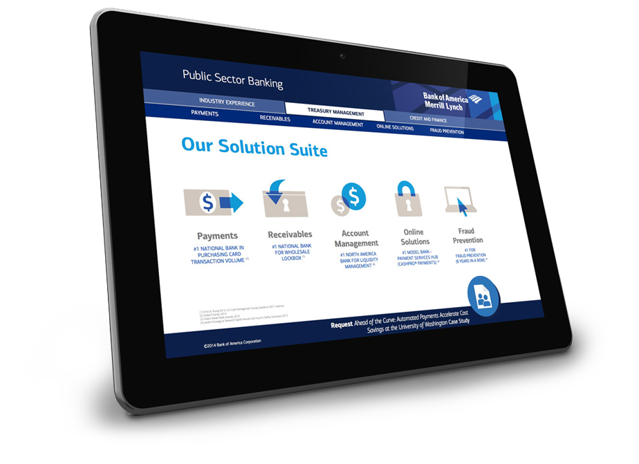
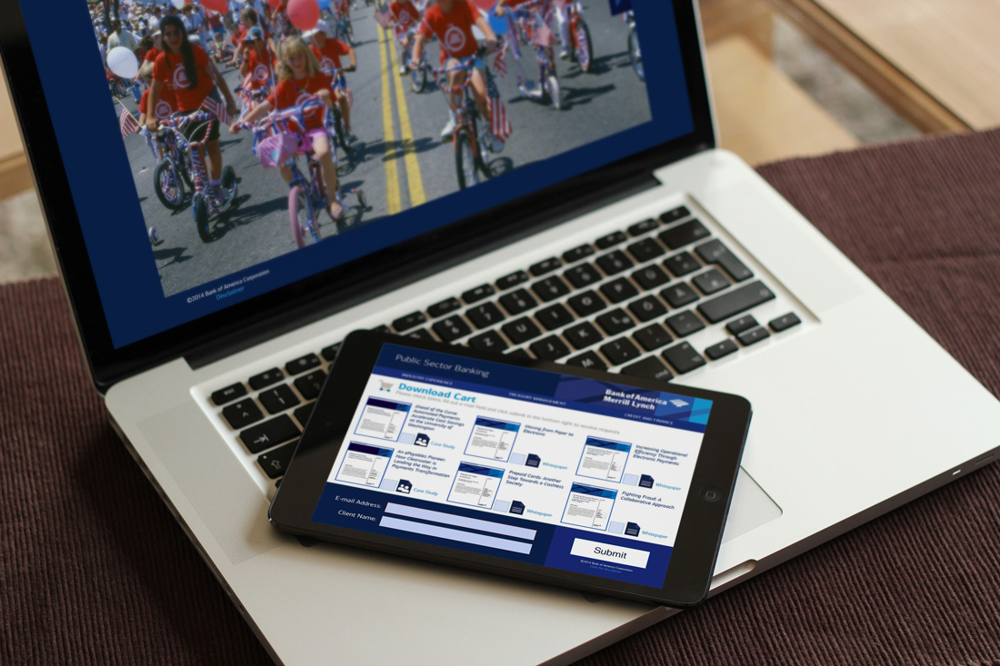
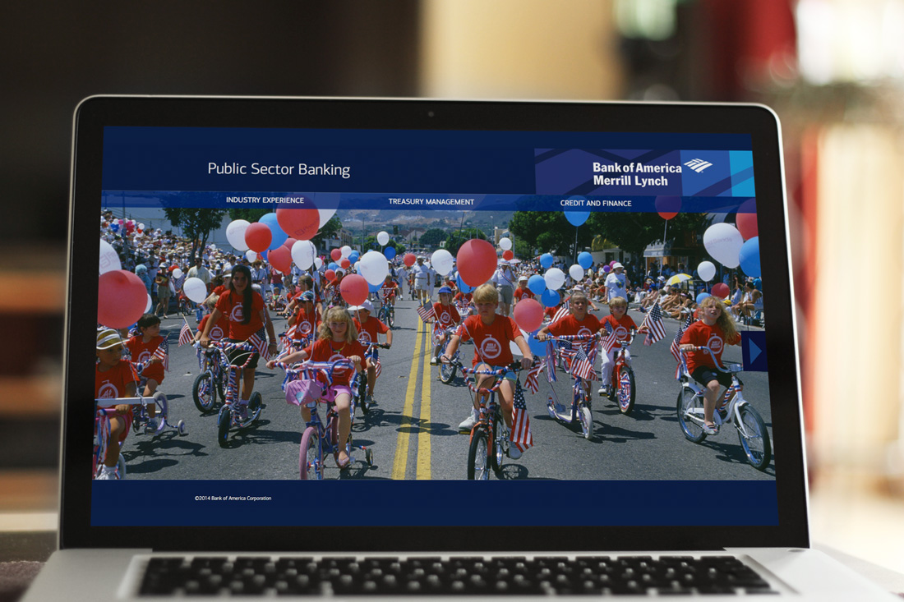
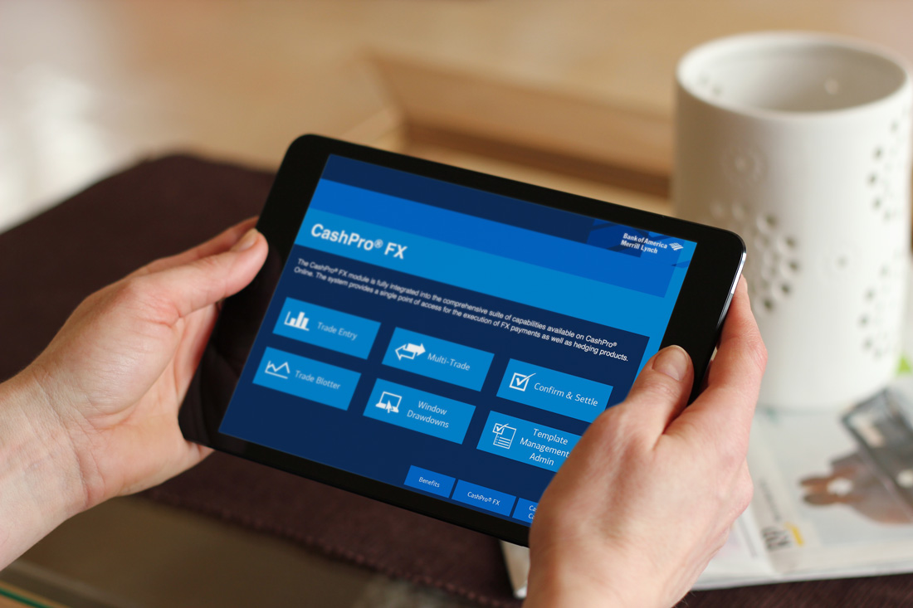
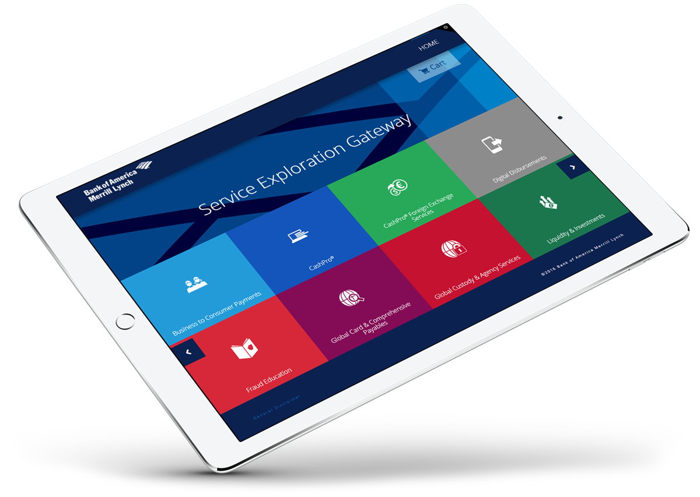
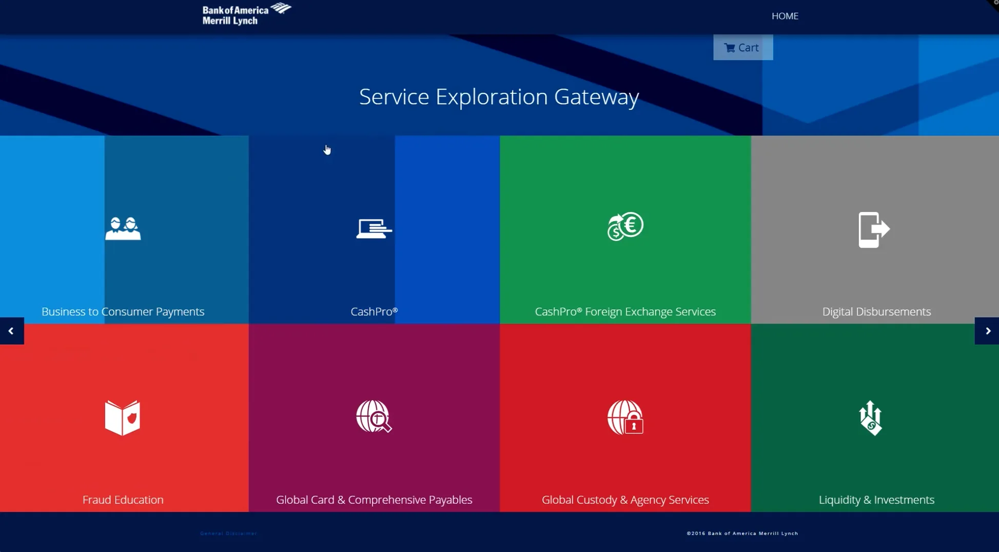
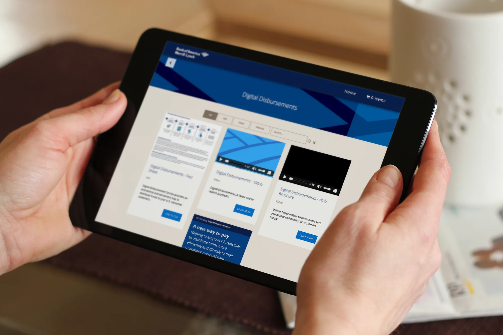
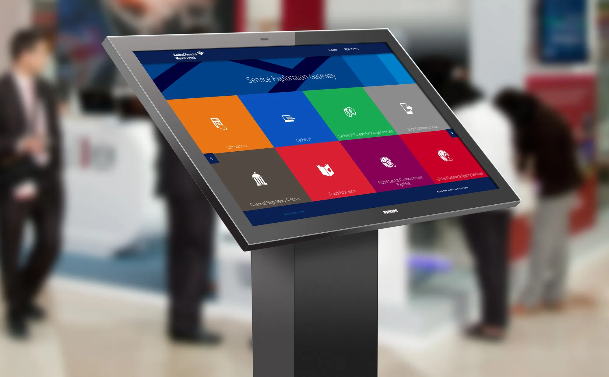
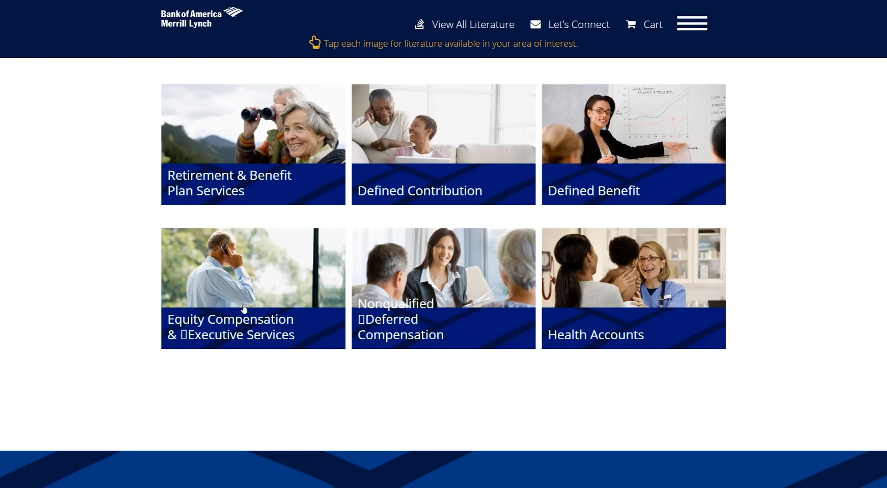

Bank of America has a lot of content that isn't particularly accessible or digestible to the average person, business, or investor.

## The challenge

This fintech had a bold vision, but needed a brand and product experience to match it.

- No clear brand identity or visual system for interactive apps
- Existing products lacked UX clarity and polish
- Messaging didn’t communicate value to users or investors

### Our approach

We helped launch the startup with a confident brand and a user-first product experience.

- Built a sleek, trustworthy brand system from the ground up
- Designed a mobile-first UI that simplified complex features
- Crafted clear messaging to support launch, growth, and funding

user journey mapping

## Specialized apps across multiple financial sectors

1. Business needs to access a PDF, video or whitepaper
2. The client reaches out to Bank of America
3. Bank of America responds with proper app containing their sector
4. The app is downloaded or visited on a browser
5. Content is explored and downloaded

Global insights and smart solutions at your fingertip

App 1

## Email & Download

### Public Sector Banking

These Bank of America employees were on PCs and were traveling to meet their prospective clients for an in person one-on-one.

They needed a takeaway that could be emailed to their client. It had to have a small file size, viewable on desktop only, and needed to be contained into a single transportable file.

We created this as an interactive PDF with Adobe InDesign

App 2

## Analytics & Cache

### Service Exploration Gateway

This app needed to be viewable on an iPad and desktop. They were unable to download apps on the company iPad so that was out of the question as well.

We decided to do a web app. I put a cache in the header so that it could be stored offline.

The CMS of the app had to be easy to navigate for the client to be able to upload new items as well. It was set up as a simple drag and drop for a PDF as well as a video. The website itself was built with a touchscreen in mind, using large buttons and simple navigation.

### Carts are for data

After adding a PDF to their cart and "checking out" the user would be emailed their documents. This allowed Bank of America to have great analytics on the data collection and they were able to reach out to any interested client while knowing exactly what they were interested in.

The main page was a huge menu so the user could dive right into what they wanted.

### On the road again

We utilized touchscreens at shows and exhibitions throughout the year to show off the website even more. This was top of mind while building.

We made sure to keep the 16x9 ratio responsive in a way to maximize the big display screen. The simple UX and large UI helped customers navigate products easily while using the touchscreen.

App 3

## Retirement and Benefit Plan Service App

This app was very similar to the Gateway and the solution to that ended up working great. The Bank of America team needed this app to be left with the client they were pitching to. This was accomplished by sending an invite to the website in an email directed to the future customer.

They were able to get granular analytics on each of their clients with a tracking link on the email to see if they needed to reach back out to them.

## 3 apps to rule them all

### Conclusion

Finding one solution to best fit multiple asks proved to be cumbersome so we chose to ask each stakeholder what they needed. Instead of a one-size-fits-all approach we found it was best to listen to the requests individually. One required it to be emailed, one had to be accessible remotely, and the last required advanced analytics.

In collaboration with:

-   Client acquisition: [Multi Image Group](https://mig.cc/)
-   Producer: [Multi Image Group](https://mig.cc/)

### Key outcomes

#### Cutting edge

A lot of what we wanted to have done, hadn't been done. Researching and producing novel ideas was a must for this set of tasks.

#### Feedback looped

All three apps had similarities in regards to gaining user information. This was invaluable to the client.

In collaboration with:

-   Client acquisition and production: [Multi Image Group](https://www.mig.cc)
