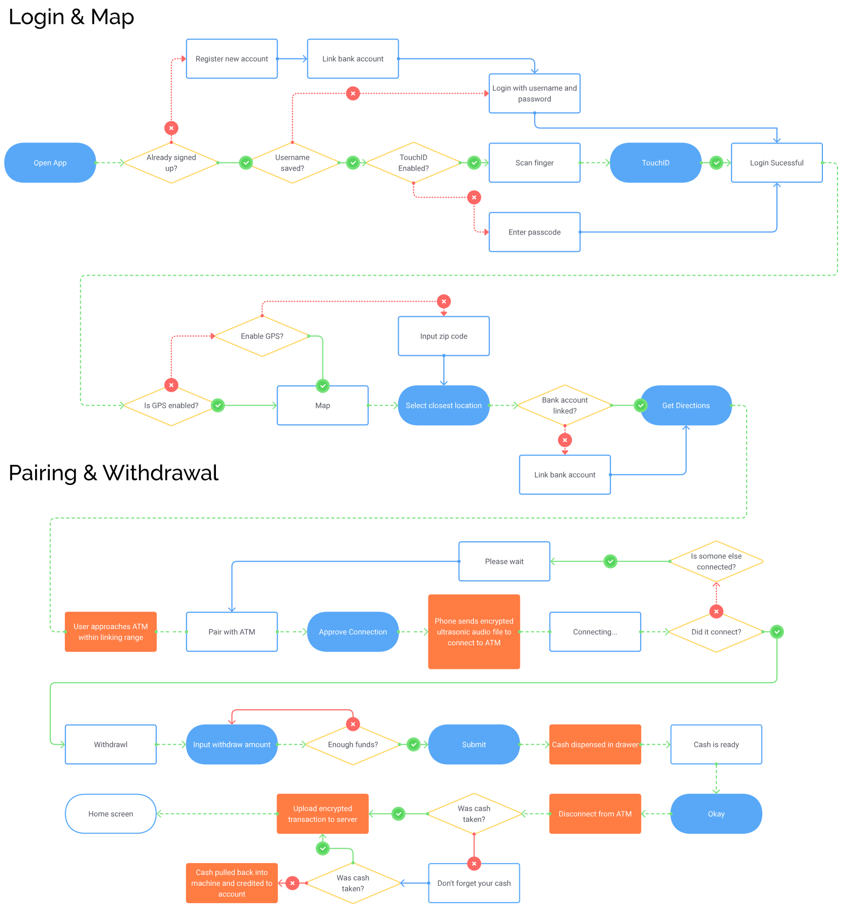
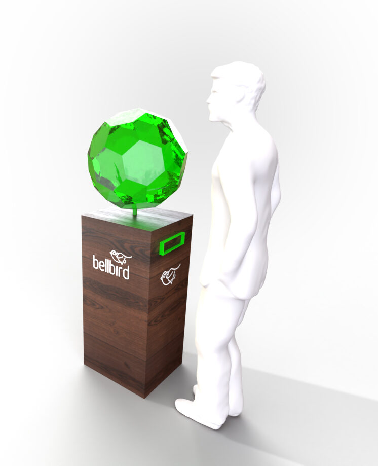
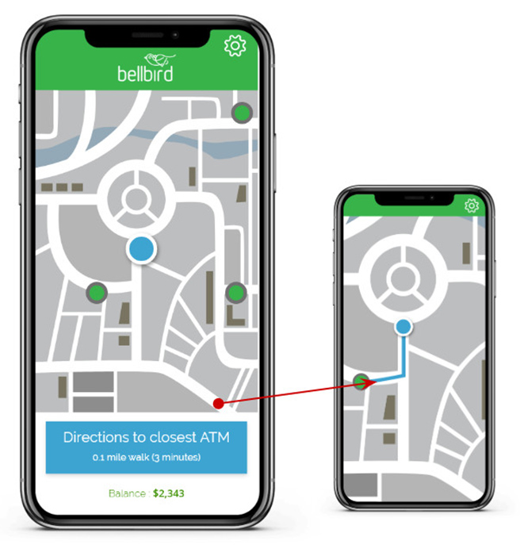
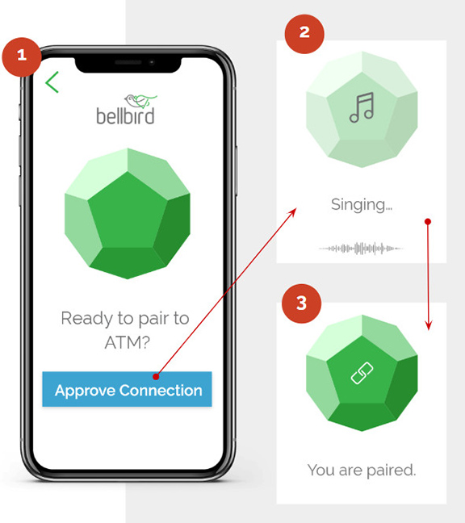
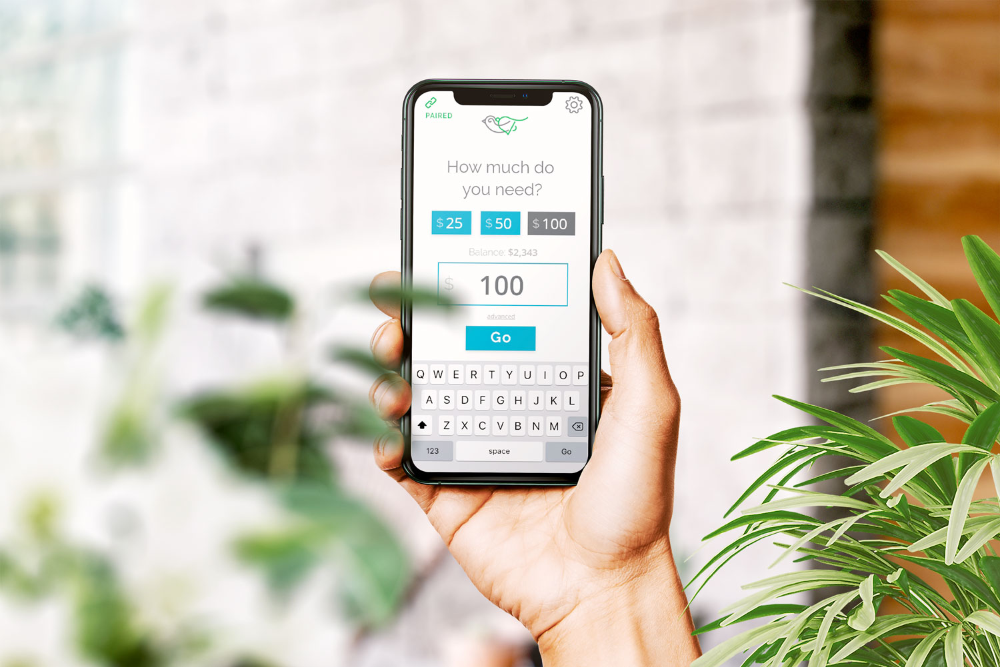
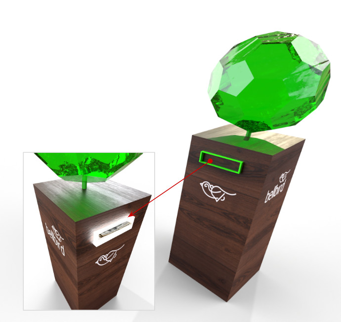

How can we shift the ATM experience to slash expenses, boost security, and ditch the outdated card system? Can we skip the screen and opt instead for an entirely new approach to a dated machine?

## The challenge

Bell Bird was ready to scale, but their brand and website didn’t reflect their momentum or position in the industry.

- Outdated design that didn’t inspire trust or credibility
- Messaging lacked clarity for both investors and partners
- No clear funnel for lead generation or contact

### Our approach

Founding Creative repositioned Bell Bird as a modern, forward-thinking player in the ATM industry.

- Developed a sharp, confident brand identity
- Clarified messaging for multiple audiences
- Built a conversion-focused site to support growth

### Hypothesis

Leveraging data-over-sound technology will result in a seamless, secure, and cost-effective pairing between phone and ATM.

### Approach

-   Creative strategy
-   Brand visual identity
-   User experience mapping
-   User interface design
-   Marketing design

user journey mapping

## Following the beat of a different drum.

1. User needs to withdrawl cash
2. User locates nearest ATM via geo finder inside app
3. User navigates to nearest preferred location
4. App recognizes proximity to ATM and asks user to pair
5. User approves pairing
6. Users device emits a unique ultrasonic sound wave signature
7. Audio signature is recognized by the ATM and illuminates
8. Encrytped user data transfersto ATM via sound waves
9. Users device and ATM both “chirp” to confirm ready to use.
10. User completes desired transaction on their device
11. ATM responds to user request, e.g. dispenses cash
12. User disconnects from ATM with an audible “chirp” confirmation

Birds encode data inside every chirp, so why can’t we?

### Designed by nature

Inspired by the loud White Bellbird, this approach champions data-over-sound technology for universal access.

### End-user benefits

Embrace cost-efficiency, elevated security, and seamless external device connectivity.

### A familiar aesthetic

Moving beyond the impersonal, digital facade, we infused nature into every aspect of the design ethos. Using intuitive audio cues and ambient lighting, we signal effortless connection.

### Persona

Chris is a 55 year old construction contractor. He regularly pays employees with cash, making upwards of 8-10 withdrawals a month.

### Login

Chris needs cash. He downloads and launches app. He is required to use TouchID for security

During his initial account registration he linked his bank account to pull money from

TouchID makes him feel safe and secure. It is simple and fast to use after an easy initial account setup

### Map

The map shows the closest ATM locations

He taps the most convenient location and navigation directions are loaded into a map he is familiar with

### Pair

A pairing screen appears when his phone’s GPS location is 10 feet proximity to the ATM

He approves the connection making him feel secure that only his phone is connected to it

The the app "sings" a new encrypted ultrasonic audio wave with the login data information for the ATM to read and connect to

The ATM plays a bird chirp followed by one from the app while connecting so he knows when it is connected

The top of ATM blinks while connecting and remains visually lit while paired

### Amount

Chris can choose between preset values or input custom amount

Algorithms can show top three most used values based on previous actions

Chris can choose denominations in advanced withdrawal menu

### Cash

His cash is dispensed, slot glows to show money is there

App disconnects from ATM, top acrylic light turns off so he knows he is no longer paired with the ATM

The ATM machine clamps down on the withdrawn cash when dispensed. An alert is sent through the app if they leave a 5 foot radius of the ATM without the cash. If a 10 foot radius is left, the ATM retracts the money and gives credit back to the account.

## An entirely new ATM experience that sings

### Conclusion

Our innovative approach to ATM design and functionality culminates in a seamless, secure, and cost-effective banking experience, leveraging data-over-sound technology.

This solution not only enhances security through encrypted sound wave data transmission but also ensures accessibility by working offline and across various platforms without the need for internet connectivity.

The intuitive external connection process, highlighted by visual and audio cues, provides a user-friendly interface that signals successful transactions and security statuses, such as cash withdrawal alerts and transaction confirmations.

### Key outcomes

#### Boosted security

Encrypted transmissions, blockchain records, and durable ATMs enhance security, preventing card theft and loss.

#### Cost efficiency

Removing cards and keyboards cuts costs in production, maintenance, and health, with SDKs making programming more efficient.

#### Convenience and safety

Alerts for forgotten cash and auto-retraction ensure transactions are convenient, safe, and error-free.

In collaboration with:

-   Client acquisition and production: [Multi Image Group](https://www.mig.cc)
