Seeking to immerse their brightest minds in a world of innovation and creativity, Mastercard needed help translating their vision into a tangible experience for attendees from start to finish.

## The challenge

Mastercard needed a standout visual system for its Innovation Forum, one that could carry across digital, physical, and motion formats at a global scale.

- No cohesive identity to unify the event experience
- Visuals didn’t reflect the forward-thinking nature of the content
- Needed to adapt seamlessly across print, stage, and screen

### Our approach

We developed a bold, flexible design system that elevated the Mastercard brand and amplified the event’s future-focused themes.

- Created a scalable visual language rooted in innovation
- Applied the system across digital, print, motion, and spatial design
- Helped Mastercard inspire and align a global audience

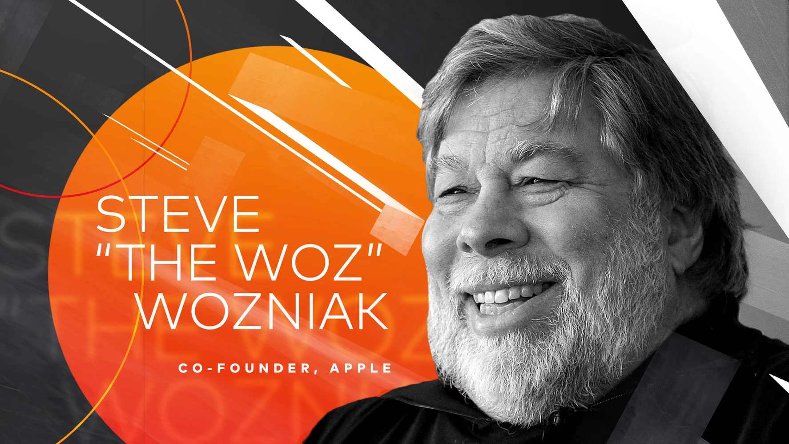

step-by-step from idea to impact

## The blueprint to innovation

1. Define the innovation-driven art direction concept.
2. Develop brand activation strategies for diverse media.
3. Design digital and print materials tailored to the event.
4. Innovate environmental design and general session stage elements.
5. Direct and create animations for the widescreen display.
6. Design presentation looks for speakers, including Steve Wozniak.
7. Execute across all platforms for cohesive brand experience.
8. Implement feedback loops for real-time adjustments.
9. Finalize and polish all creative deliverables for the event.

The culmination of design and strategy that transformed the Mastercard LAC Innovation Forum into a breakthrough event.

## Branding

### A breakthrough theme

The dynamic interplay of bold geometric shapes and a stark color palette evokes a sense of disruptive innovation.

Deliberate lines and angular designs suggest precision and cutting-edge technology, aligning with the event's focus on forward-thinking financial solutions.

This art direction successfully captures the spirit of the forum: a catalytic event driving the industry towards uncharted territories of opportunity and growth.

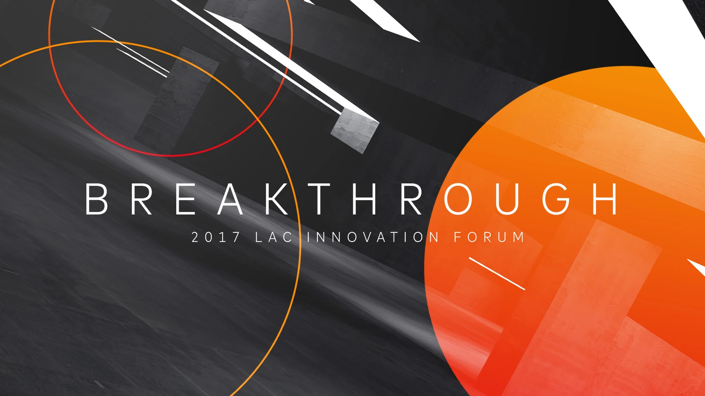

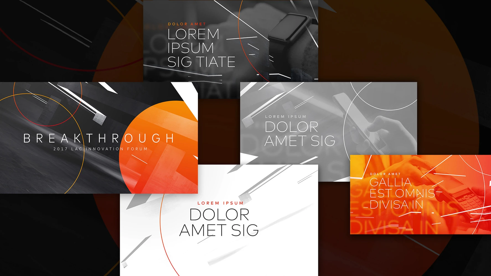

## Digital disruption

From pre-communications to registration to post-communications, each step of the attendee journey was mapped out and designed around the user. A strategic roadmap was created to guide users from a place of familiarity, to a place of innovative breakthrough.

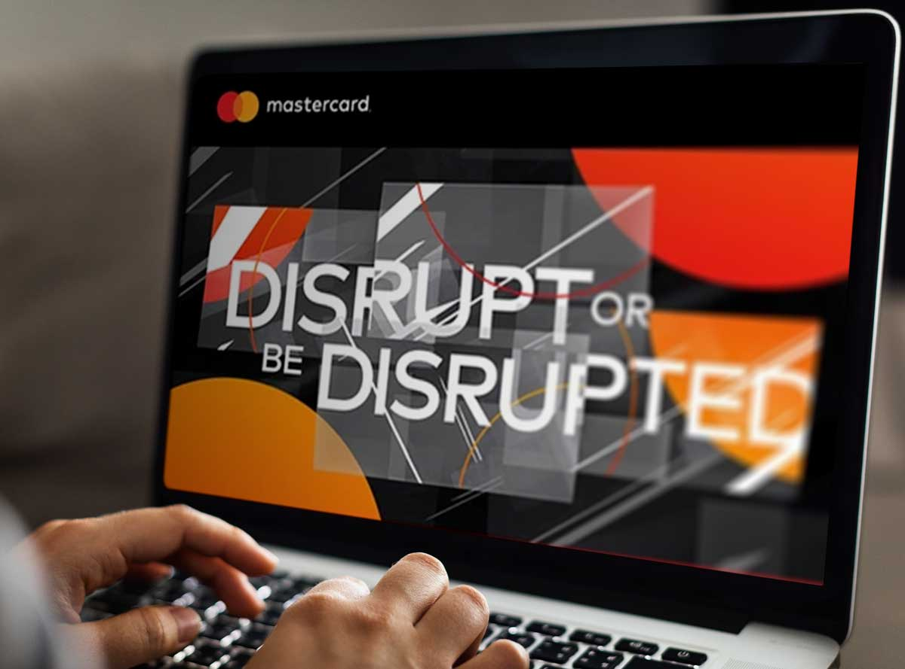

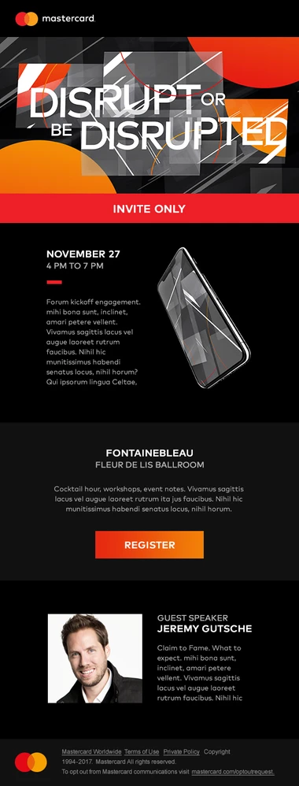

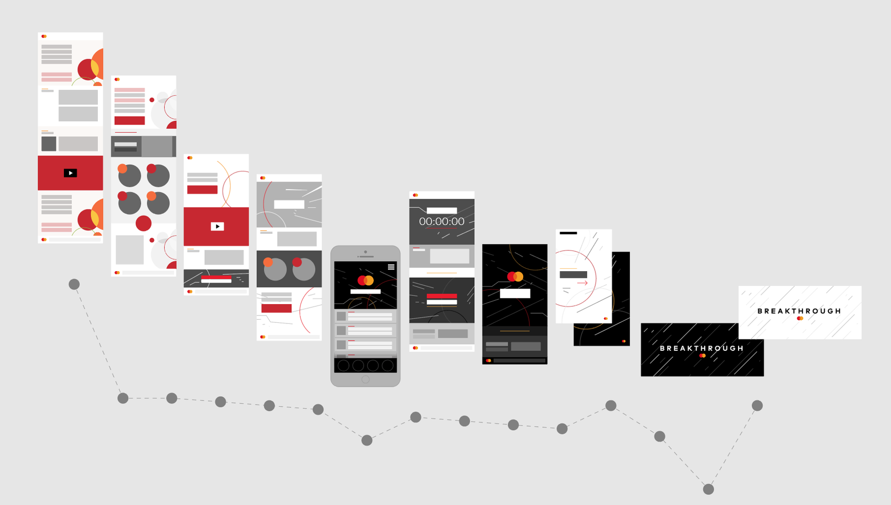

## Powerful print design

Anything but dead, print has the immense power to transform an experience instantly.

To evoke the earth-shifting ethos of the event's theme, Breakthrough, an illusionary focal point was developed to transport attendees to a new frontier. Supporting print materials continued this narrative both in and out of the hands of those attending.

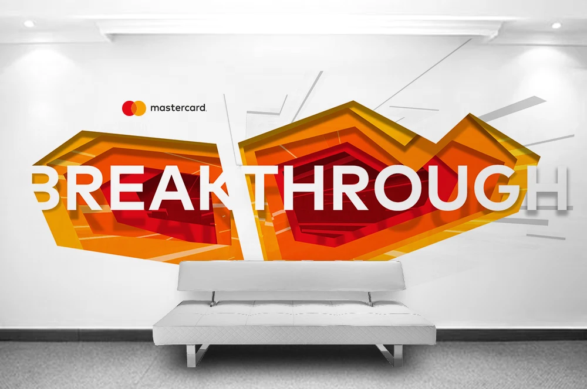

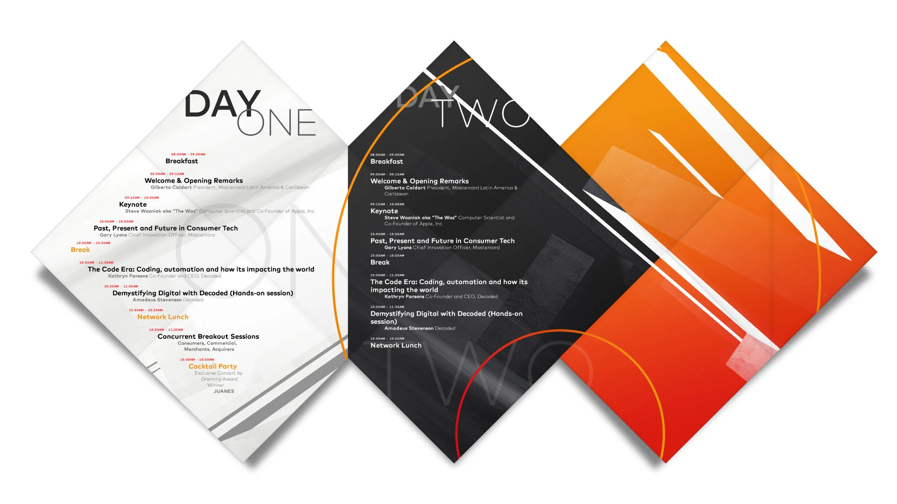

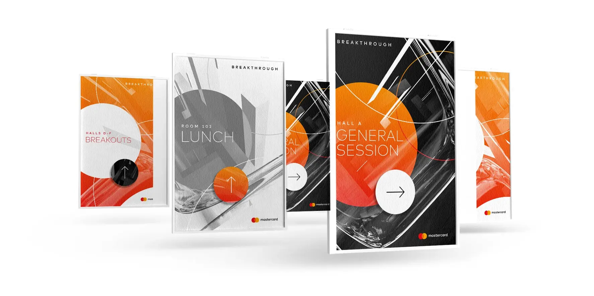

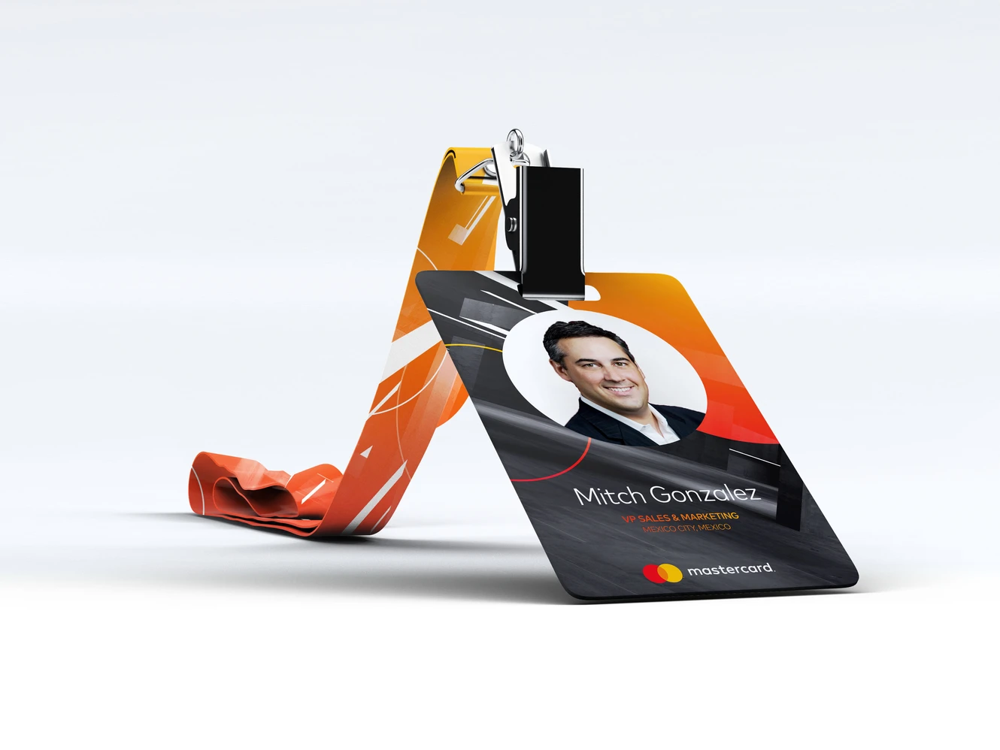

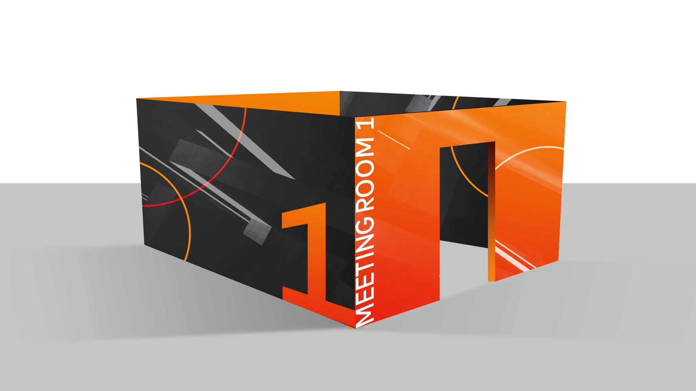

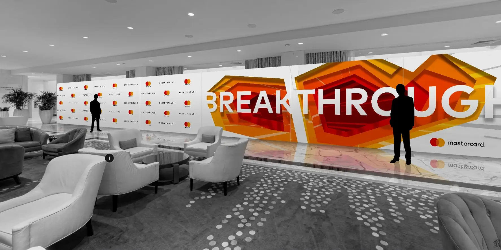

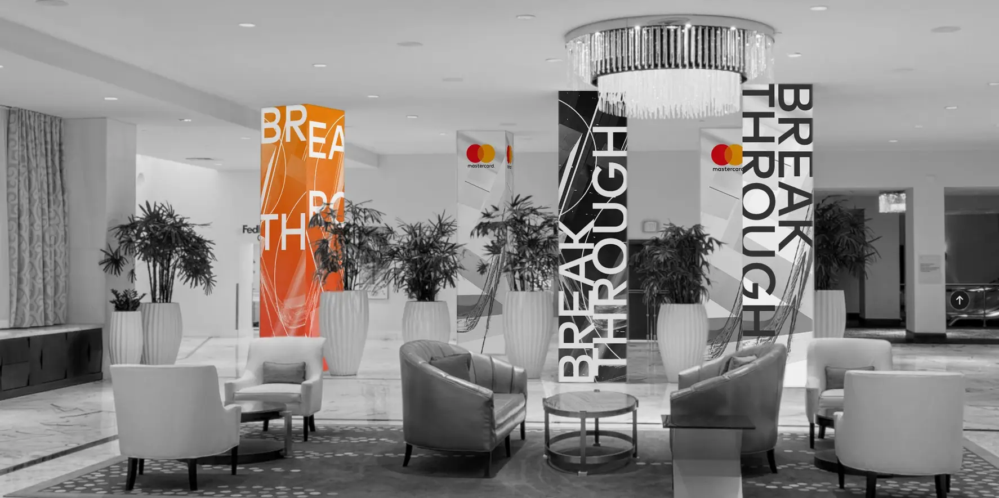

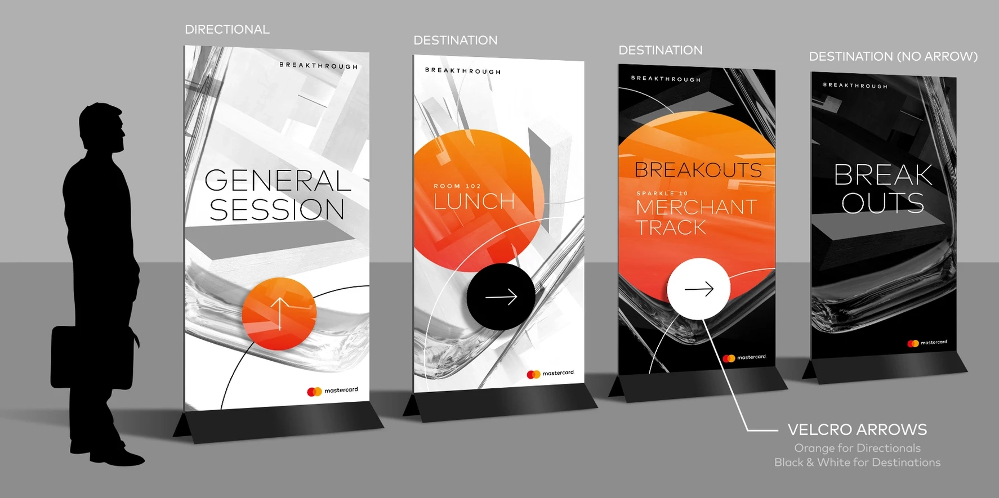

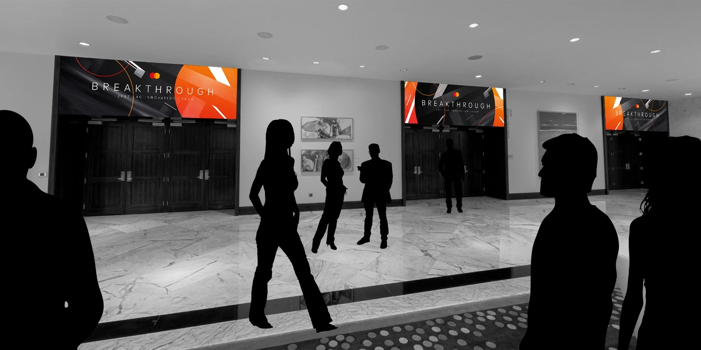

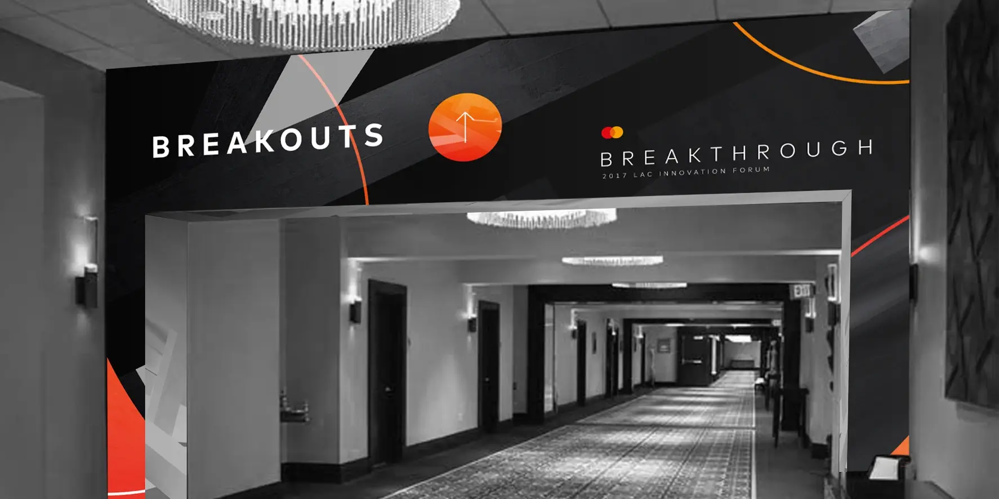

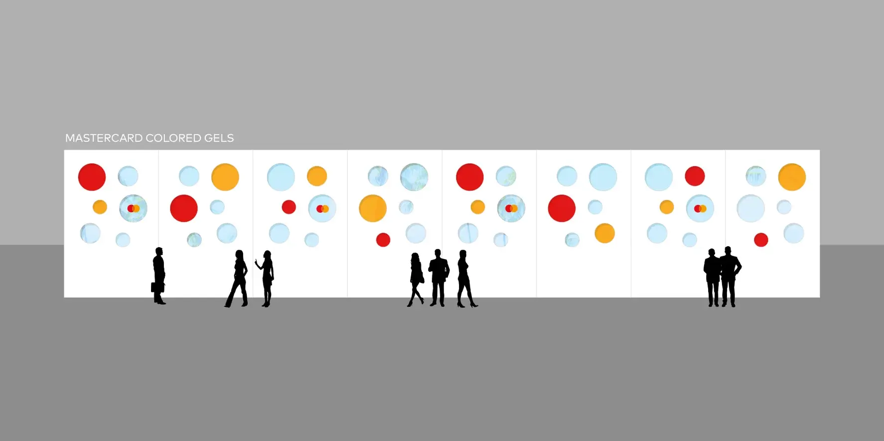

## Over one hundred feet

Creating captivating energy on a standard widescreen is challenging enough. But this event made use of a custom screen over 100' wide. Ensuring visual narratives were optimized for this amazing canvas had a wonderful payoff. 

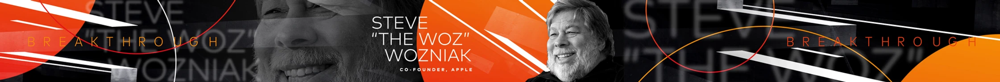

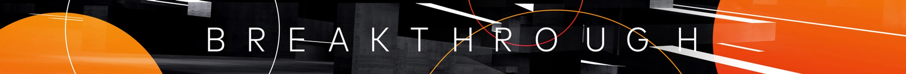

## Fueling an environment that fosters innovative minds

### Conclusion

Through imaginative art direction, comprehensive brand activation, and seamless execution, Founding Creative not only met but surpassed Mastercard's aspirations for the LAC Innovation Forum.

The forum became a living canvas, displaying the transformative power of creativity in financial innovation. Our holistic approach melded aesthetics with functionality, creating a symphony of visual storytelling that resonated with every participant. The result was not just a successful event, but a defining moment that underscored the invaluable impact of creative partnership.

In collaboration with:

-   Client acquisition and production: [Multi Image Group](https://www.mig.cc/)

### Key outcomes

**Broadened engagement**

The innovative stage and digital animations significantly increased attendee engagement and satisfaction.

**Enhanced brand perception**

Cohesive branding across all materials elevated Mastercard's image as a leader in innovation.

**Inspired** **innovation**

The event successfully sparked creative thinking among Mastercard members, encouraging the development of pioneering financial solutions.

In collaboration with:

-   Client acquisition and production: [Multi Image Group](https://www.mig.cc)
