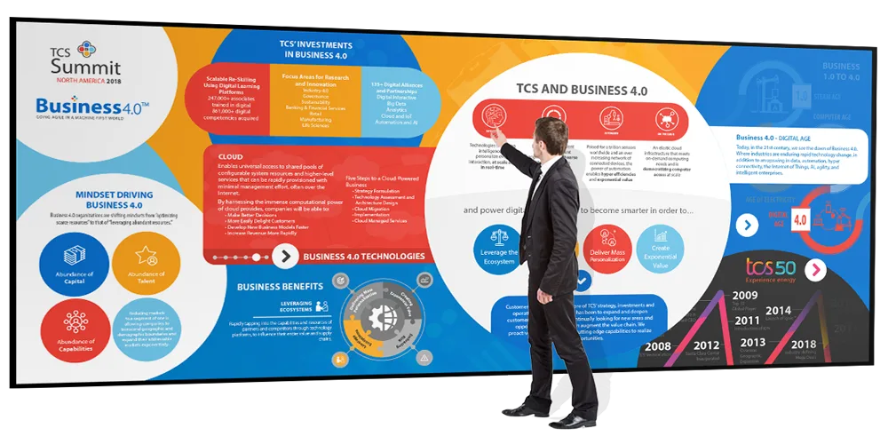
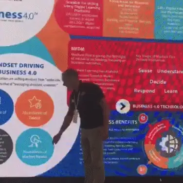
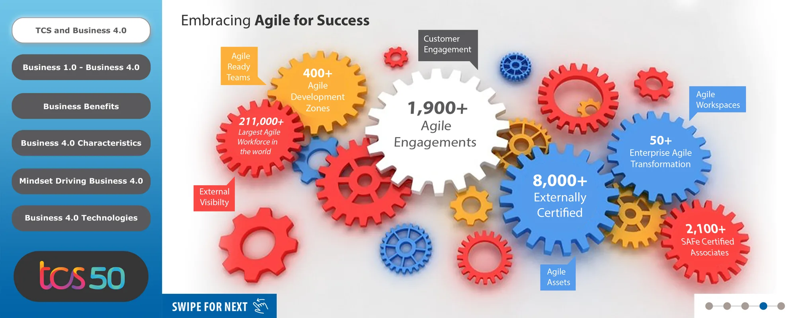
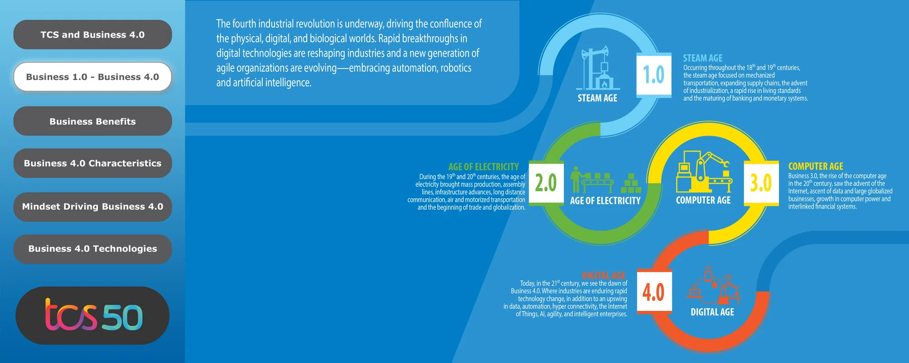
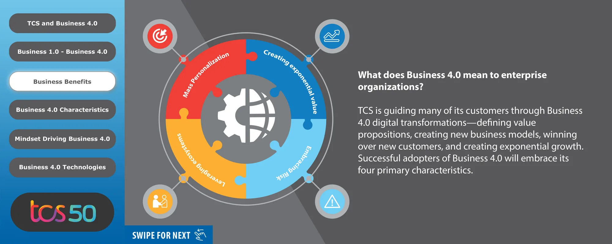
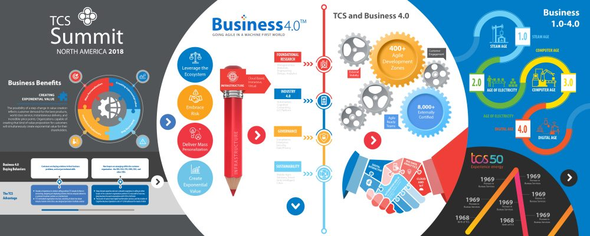
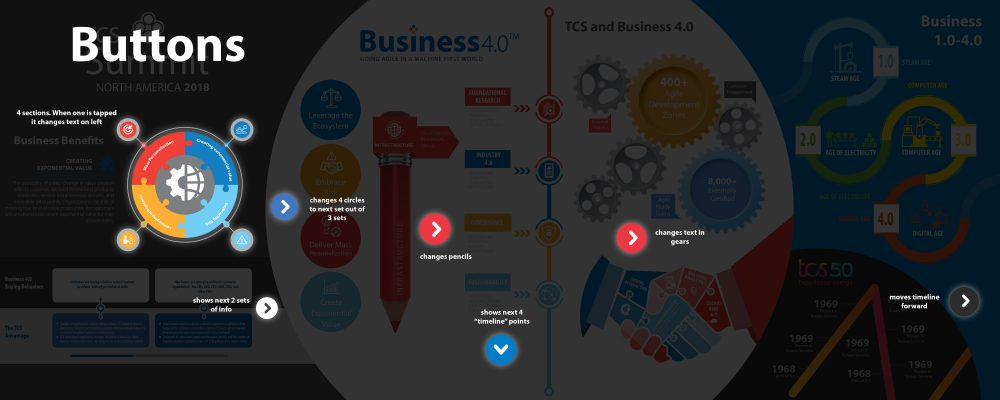
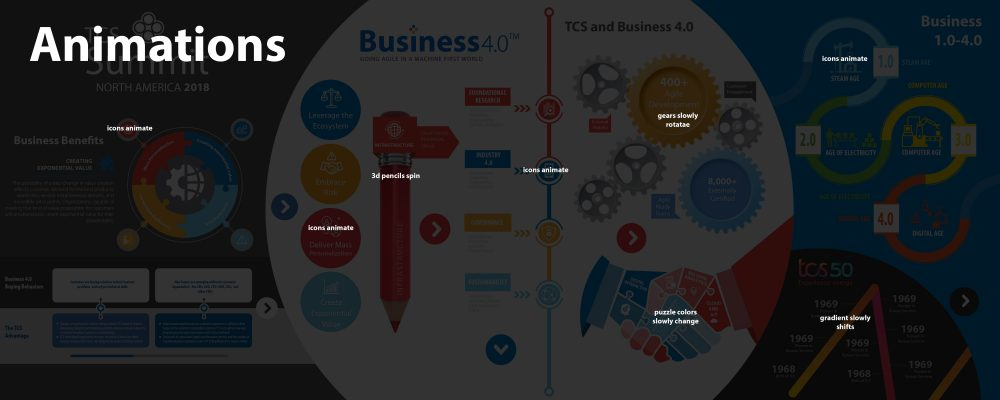
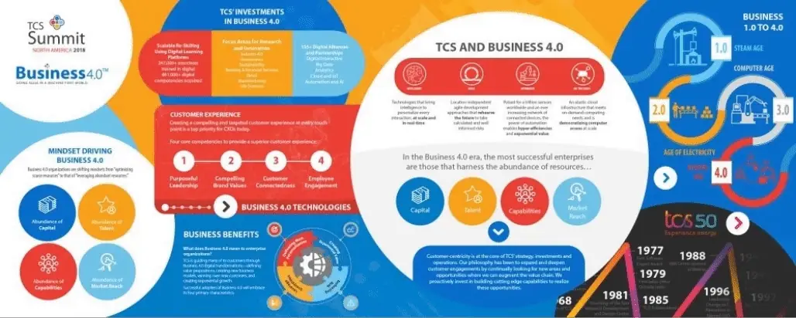

Tata provided a 44-page company info document to educate customers at a large event, we made it an experience

## The challenge

The client wanted a one-of-a-kind mural experience that merged physical space with digital storytelling, and captured attention in a busy conference environment.

- No existing concept that bridged physical art with real-time interaction
- Needed to engage a wide audience quickly and memorably
- Tight timeline with high technical and creative demands

### Our approach

We designed and developed an immersive mural that blended tech, art, and brand narrative seamlessly.

- Created an interactive digital layer synced to a physical mural
- Designed a bold, on-brand visual experience to stop traffic
- Engineered a turnkey system for setup, engagement, and analytics

user journey mapping

## Multiple users, aproachable

1. Users would leave meeting hall and pass interactive mural
2. User would approach wall and tap animated button
3. Multi- touch will allow multiple users to approach simultaneously
4. User would tap and mural would change based on interaction
5. Content is explored and user learns about aspects of business

## Tata is an Indian multinational conglomerate holding company with $100+ billion revenue

## Fine-tuning

### Menu

When we first received Tata’s 44 page text document of the content they wanted on the touchscreen we were a little overwhelmed. After reading through it all and digesting the message that they wanted to convey, we broke the document into sections and chapters.

### First round

Our first designs used a menu on the left side with a website design in mind. Upon reviewing this on a test screen setup we realized it would only allow one person at a time to interact with the presentation.

This was very limiting and would waste valuable real estate offered by a huge touch surface.

### Learnings

We scratched the menu idea and spaced out the buttons to interact with. This is a multi-touch wall, we needed to capitalize on the ability of the hardware to allow multiple people to play with it at the same time. Our design thought was to make this go from a single user website to a multi user playground.

## Outcome achieved

### The final version

I went through multiple variations on how to best accomplish this and ended up formulating big approachable buttons that pulsed to show they were touchable. These would trigger individual interfaces with their content. I used bright, big, bold colors to make it friendly and playful.

The final product was colorful and I designed the UX to only go 4 layers deep at max in order to not confuse the user. I made the UI large and approachable and simplified the buttons and touch-points. The buttons were animated to show that they were interactive.

## Education made fun

### Conclusion

Finding one solution to best fit multiple asks proved to be cumbersome so we chose to ask each stakeholder what they needed. Instead of a one-size-fits-all approach we found it was best to listen to the requests individually. One required it to be emailed, one had to be accessible remotely, and the last required advanced analytics.

In collaboration with:

-   Client acquisition: Multi Image Group
-   Producer: Multi Image Group

### Key outcomes

#### Approachable

The large UI, subtle animations, and bright fun colors made the mural approachable so people felt comfortable using it.

#### Engaging

There were multiple sub-menus to explore with endless possibilities for interaction and learning/

In collaboration with:

-   Client acquisition and production: [Multi Image Group](https://www.mig.cc)
