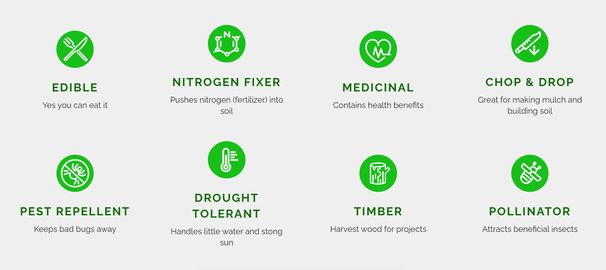
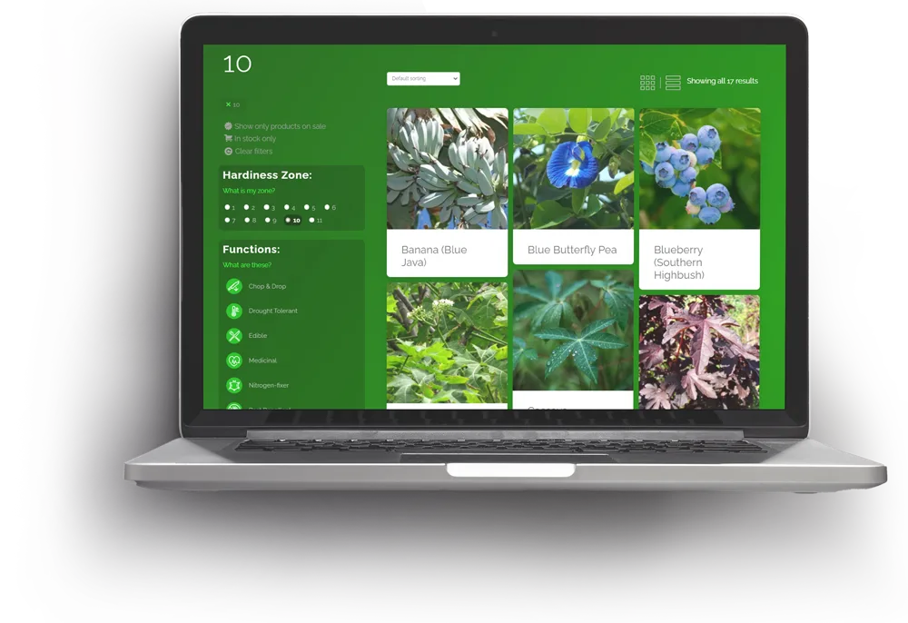
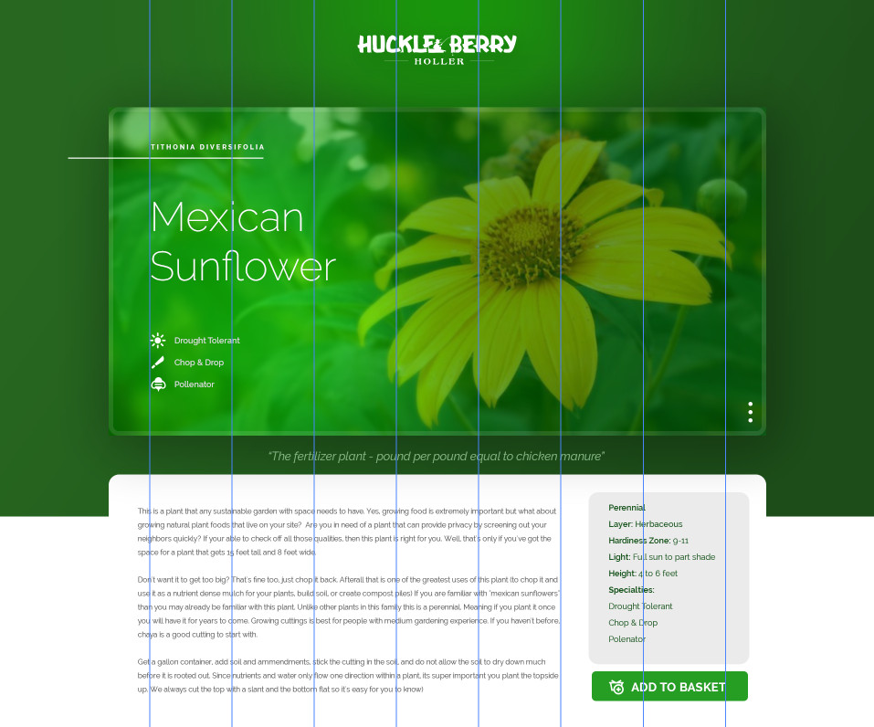
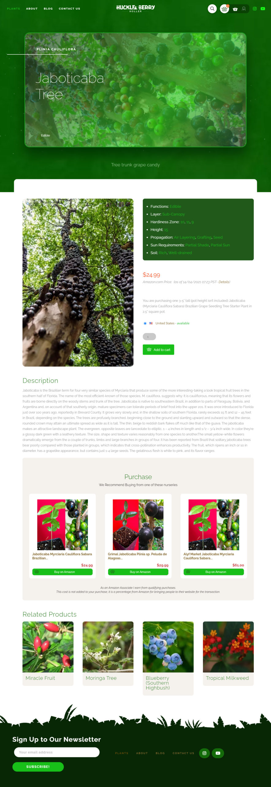

Sustainable agriculture education on plants doesn't offer a path to purchase. Nurseries lose money when items are out of stock.

## The challenge

The nursery was growing fast, but their outdated eCommerce platform couldn’t keep up with the business or customer expectations.

- Clunky checkout experience that led to drop-offs
- No support for subscriptions or repeat purchases
- Lacked a cohesive visual identity and brand story

### Our approach

Founding Creative transformed the brand and digital experience to support long-term growth.

- Redesigned the shopping flow to boost conversions
- Integrated subscription-based features and flexible product bundles
- Crafted a warm, nature-inspired brand system

user journey mapping

## Education leads to sales, sales leads to sustainability

1. Needs to find plants
2. Learns about plant functions in the sustainable agriculture system
3. Pinpoints user's geographic area and range of climatic conditions relevant to plant growth and survival (hardiness zone)
4. Chooses functions they are interested in (ex. drought tolerant and medicinal)
5. Plant database filters based on criteria
6. Chooses plant
7. Learns about sun requirements, watering needs, propagation, etc.
8. Orders plant directly from the nursery
9. If not in stock links to plant on Amazon through API
10. Nursery gets direct sale or Amazon Affiliate commission

Ecologically regenerative food forest nursery that specializes in unique edible plants as well as plants to fill specific functions in agroforestry and permaculture designs.

## Goals

Education on plant functions with a filtering tool.

Revenue, regardless if it is in stock or not.

The website must be easy to navigate and simple to use. The agriculture industry can be confusing and intimidating for people that feel they don't have a "green thumb."

<video src="/media/case-studies/plant-nursery-ecommerce/video-1.mp4" poster="/media/case-studies/plant-nursery-ecommerce/video-1-poster.webp" autoplay muted loop playsinline preload="metadata"></video>

### Website Features

We made some JavaScript animations on the website's homepage to entice the customer to explore and learn. It featured a breakdown of the common plant functions, the staff's favorite plants, newsletter sign-up, blog, shopping cart with checkout, easy backend database for staff to add new plants.

<video src="/media/case-studies/plant-nursery-ecommerce/video-2.mp4" poster="/media/case-studies/plant-nursery-ecommerce/video-2-poster.webp" autoplay muted loop playsinline preload="metadata"></video>

### Branding

We made the logo, branding, and animations for the farm in order to have a uniform look. We naturally choose a green palette. The farm is based in South Florida, it has a lush tropical jungle look.

Founding hired a professional drone pilot to film and animated a simple intro for their Youtube channel.

## Functions & Filtering

### Education

The first goal of the website is education. This is accomplished by blog posts and the almightly plant filtering system. First, we identify the functions and give them their well-deserved badges. After explaining the functions and why each is important we lead them to the filter.

### Grow where you live

On the plant page, we have the options for filtering. First, they will find their Hardiness zone based on where they live. Next, they can check and explore which plants are best for them and their needs. There are multiple toggles and options for viewing and organizing their curated plant list.

### Plant pages personified

Once a plant is selected that specific plant will be displayed with all information about it. This page can be used as a resource for planting instructions and will include things like watering, sun, and soil requirements. Here the user can also learn about techniques used to propagate the plant as well as highlight its specific functions.

## Shopping & Revenue

### Header

The top of this page features a large image of the plant that has a Javascript overlay applied to give it a bright green hue. The name, scientific name, and function are automatically pulled from the plant's MySQL database.

Under the header is a sentence that makes this plant special.

### Gallery and Info

Next, we have an image gallery and the plant's information pulled from the MySQL database. These are linked to a page where the customer can find others in that specific category.

### Pricing

If the plant is in stock at Huckleberry Holler's nursery it will show that price made by them. If it is out of stock it will automatically pull the latest price for that same plant on Amazon using an API. The "Add to Cart" button is linked to the SKU based on the availability (ie if it is out of stock it links to Amazon's SKU)

### Recommended Plants

These 3 offerings are updated every 20 minutes based on a direct Amazon API search that pulls based on that specific plant's details.

### Related Plants

These 4 offerings are pulled from a similar algorithm based on the plant's information in the MySQL database.

## Infinite stock and less returns

### Conclusion

Huckleberry Holler was thrilled with the creative solution for their industry, pioneering a new type of nursery site. A after-thought highlight of linking to other nurseries if the item isn't in stock is the creation of a plant-loving wholesaler community. Plant shops are able to link to others and still gain revenue through commission if the order can be fulfilled by a friend. This was a win-win for the permaculture community.

The website creates a steady stream of passive income without having any stock of plants. When the nursery has an unforeseeable weather condition and loses the entire inventory, they still are able to generate revenue through commission sales. When back and ready to sell they can quickly slide into gaps of order fulfillment.

### Key outcomes

#### Unlimited plants

The backend of the website was built so that out of stock items were still added to the cart. When they went through checkout it would direct them to a third party that has it in stock. Sales commissions were received from these other nurseries. This user journey was a lot better as this industry often has plants out of stock due to fluctuations in temperature, pets, water, etc.

#### Less death

There are less returns of plants because the site matches the temperate zone of the customer with the plant. A customer ordering a mango tree while living in Michigan is warned that the conditions are not suitable to grow there. This education helps the customer choose the best plant for them.

In collaboration with:

-   Client acquisition and production: [Multi Image Group](https://www.mig.cc)
