An innovative team of entrepreneurs went on a mission to create a gun safety product

## The challenge

SafeZone was building powerful AI-driven safety tech, but needed a brand and product experience that earned trust and clearly communicated value.

- Brand felt too clinical and failed to build emotional connection
- Product UI lacked clarity for critical use cases
- Messaging didn’t resonate with enterprise buyers

### Our approach

Founding Creative reimagined the SafeZone brand and platform to feel both cutting-edge and human-centered.

- Developed a trustworthy, approachable brand identity
- Designed a clear, intuitive UI for high-stakes environments
- Refined messaging to align with enterprise decision-makers

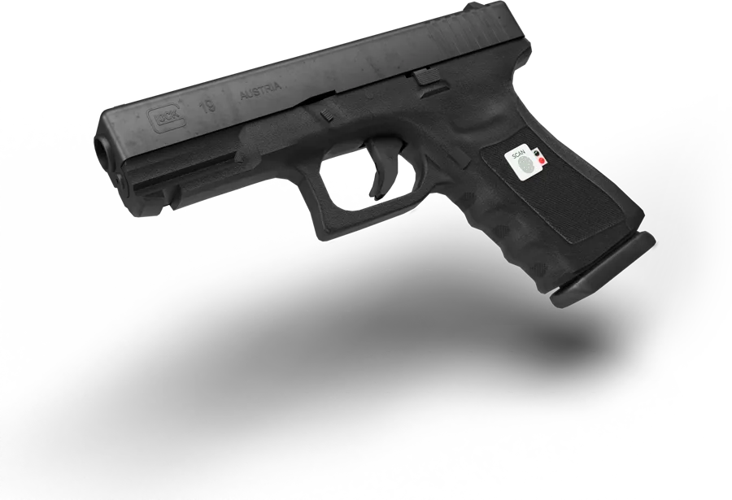

user journey mapping

## A much needed product brought to your fingertips

1. A brand toolkit was made, including a logo, design elements, colors, and fonts
2. 3d renders were created to help visualize the innovative product
3. A strategy for UX was created for the app with wireframes
4. High-fidelity app screens were created to show the user journey
5. Presentation decks were made to help inform customers and audiences.
6. The SafeZone team was rewarded for all their hard work

SafeZone enables fingerprint authorization for the set users, while still having ease of accessibility in times of defense.

### Branding

The logo has a bold tech look to match the product. The identifying feature of the SafeZone gun is it's ability to scan a fingerprint for unlocking the device. This is featured inside of the target area.

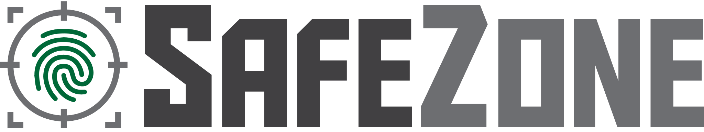

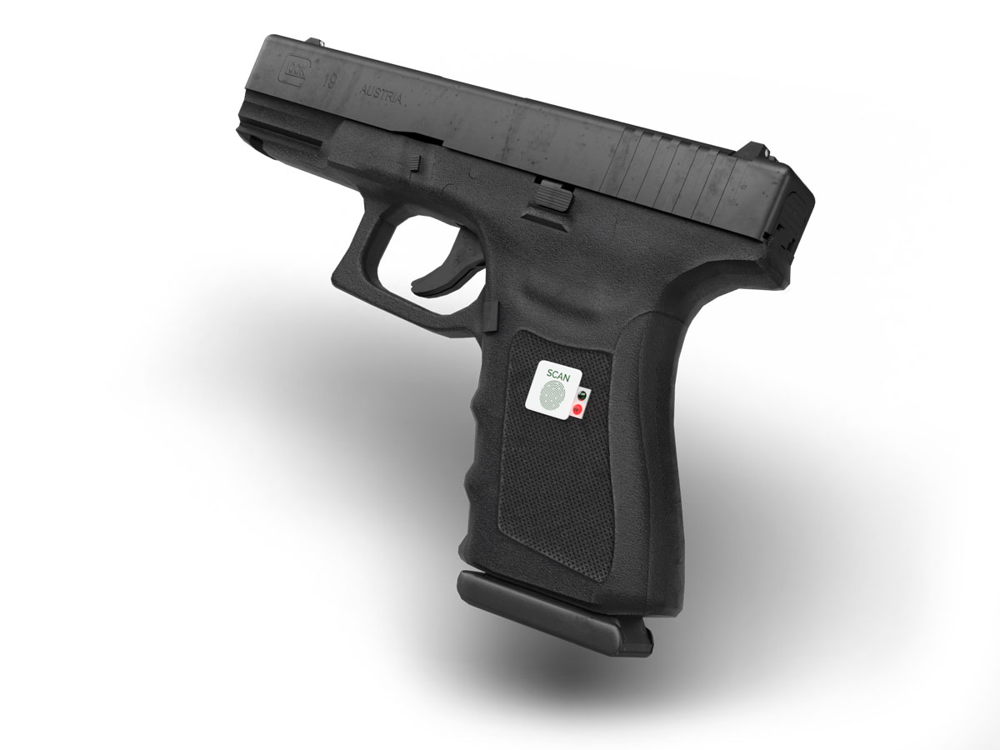

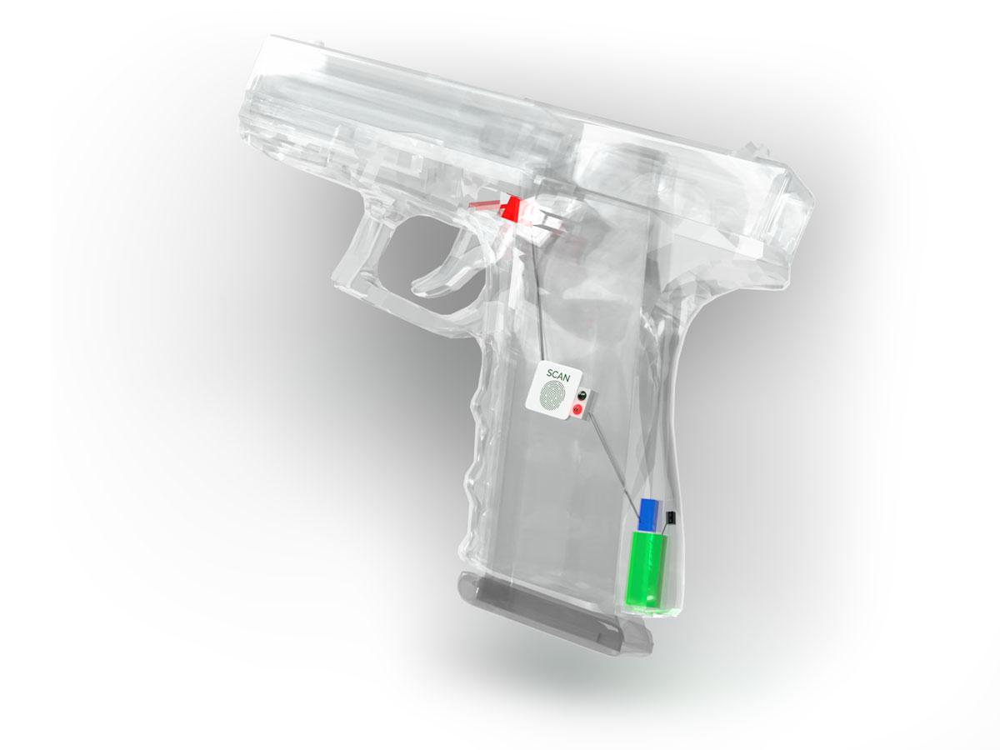

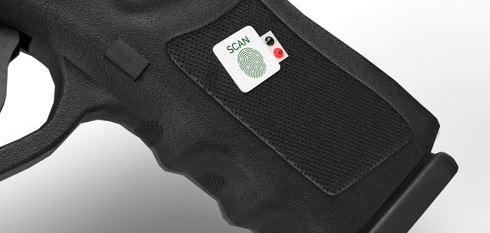

### Bringing it to life

SafeZone needed to show potential investors and customers what their vision of the gun would look like. After a few revisions the fingerprint scanner was moved to the grip of the gun, allowing it to have a more seamless operation. Transparent 3d mockups were rendered to show the inside mechanics of the product.

### A connected app

SafeZone needed an app to connect with the guns internal hardware. The app featured a scanner to securely unlock the interface. Once open you are able to utitize the main functions of SafeZone. The app tracks the location, plots points where the gun can't be used, and allows additional fingerprints to be added.

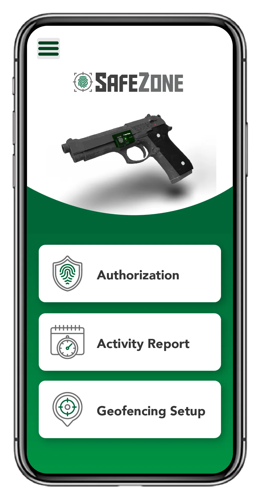

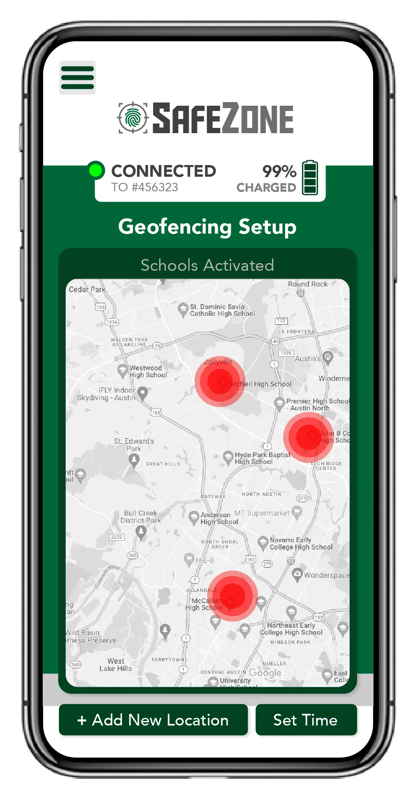

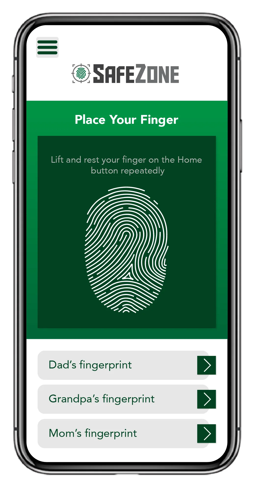

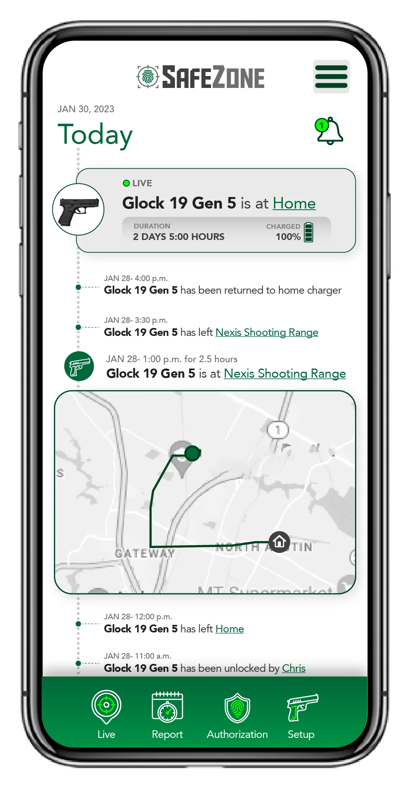

### Where and When

One of the most important parts of the SafeZone experience is it's ability to track where the gun is located and generate a history log. This UX needed to be simple and easily scannable at a glance when time matters most.

### Stay alert

Notifications are sent to the gun owner when the location has been moved, left a specified area, needs to be charged, and more. This give the owner the peace of mind when away from the gun, keeping it safe from friends, family, and any uncontrollable circumstance that may happen.

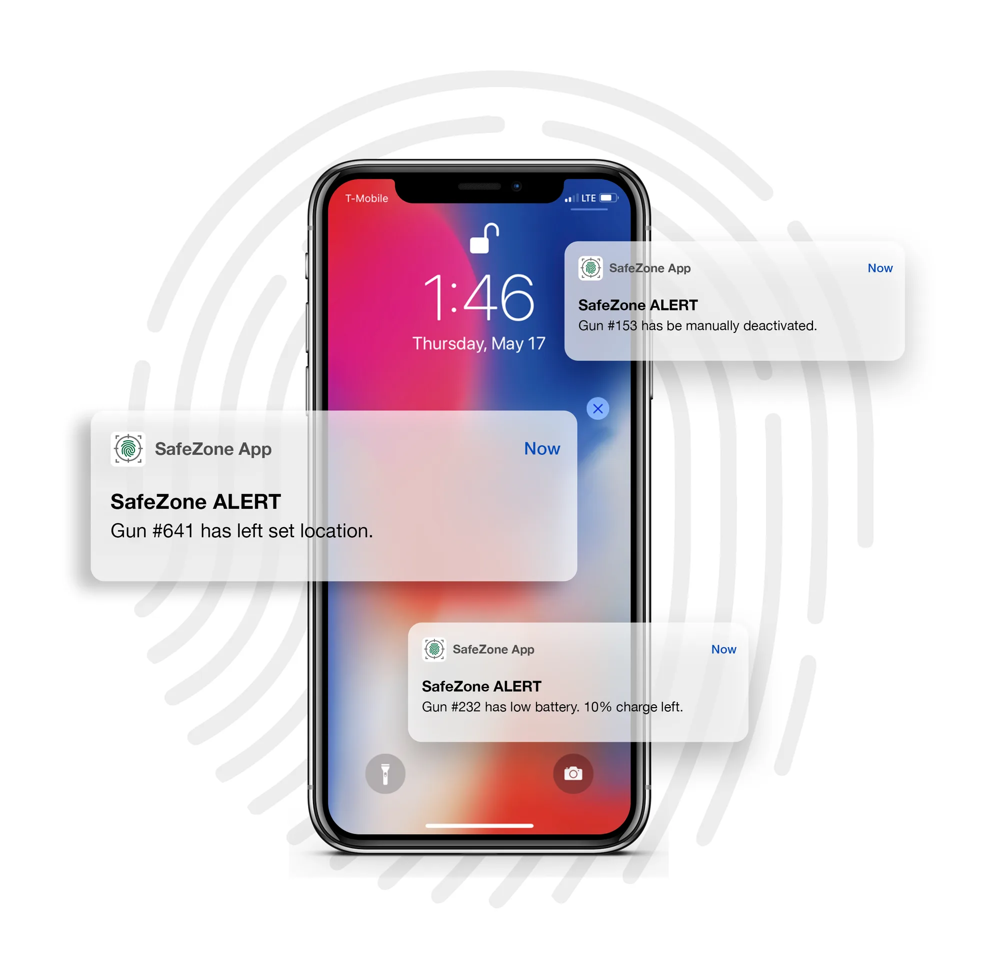

## Designed for safety

Instantaneous fingerprint authentication keeps your gun from only being operated in the right hands, yet easily accessible when needed in emergencies.

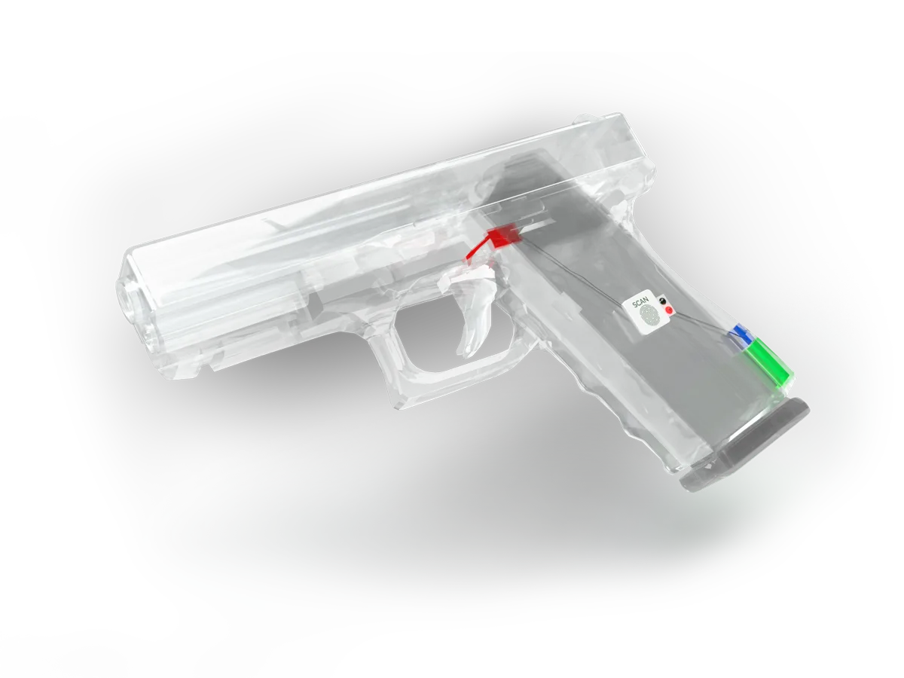

## A big problem needs an even bigger solution.

### Conclusion

The SafeZone team astonished the crowd at Westlake Business Incubator. Their hard work, dedication, and inspiring mission landed them with multiple wins and awards. The designs helped them get closer to their amazing mission to strive to create safety and belonging in every community. SafeZone is constantly working toward neutralizing the gun safety conversation, by caring about the potential lives saved, not political debates, and further introducing a modern approach to the gun safety market.

In collaboration with:

-   Client: [SafeZone](https://www.safezonewhs.org/)
-   [Joey Spier](https://www.linkedin.com/in/joey-spier-9a5617265/), [Annika Nanda](https://www.linkedin.com/in/annika-nanda05/), [Mirabel Finger](https://www.linkedin.com/in/mirabel-finger-b49321293/), [Jake Yokubaitis](https://www.linkedin.com/in/jake-yokubaitis-aa2740191/)

### Key outcomes

#### Design brought an inventive idea to life

The 3d renders helped visualize a groundbreaking product, the first of it kind. The app user interfaces reestablished the look and feel, a minimalistic and simple design that would be easy to navigate in a potentially high-stress scenario.

#### Brand identity

The logo, colors, and design elements positioned their brand to shine its best. SafeZone used this toolkit to make collateral like posters, presentation slides, and more.

In collaboration with:

-   Client acquisition and production: [Multi Image Group](https://www.mig.cc)
