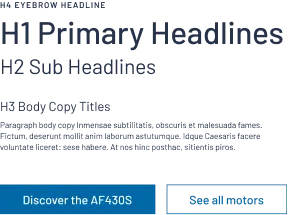
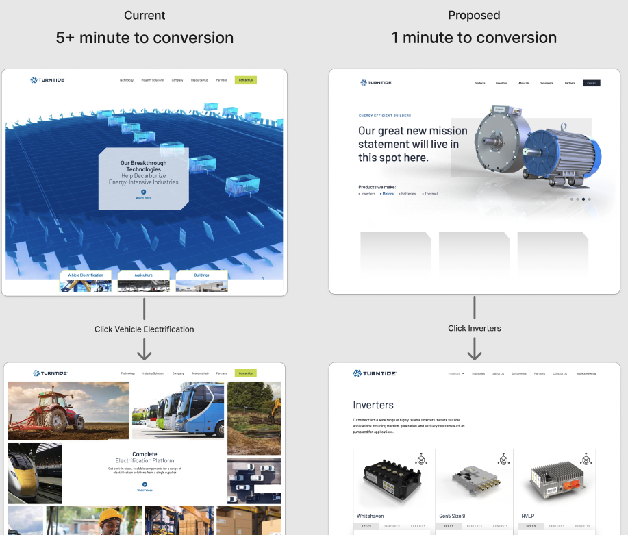
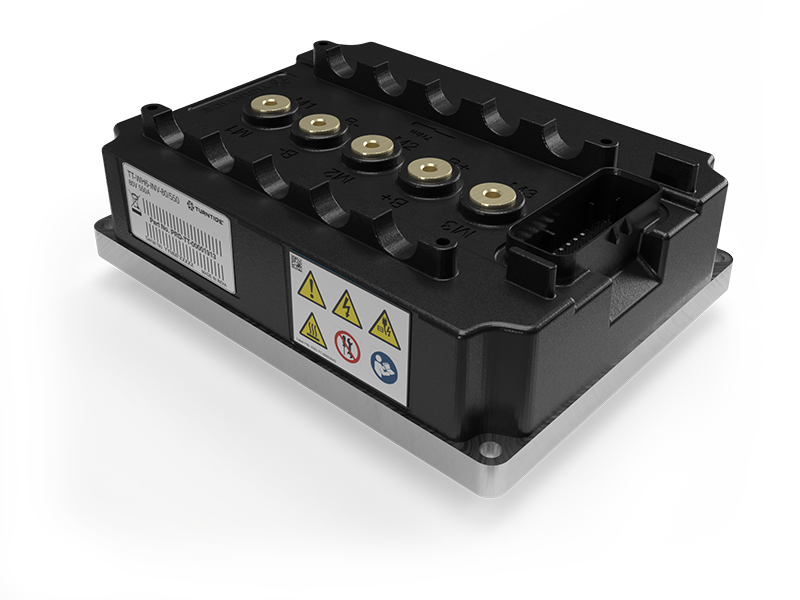
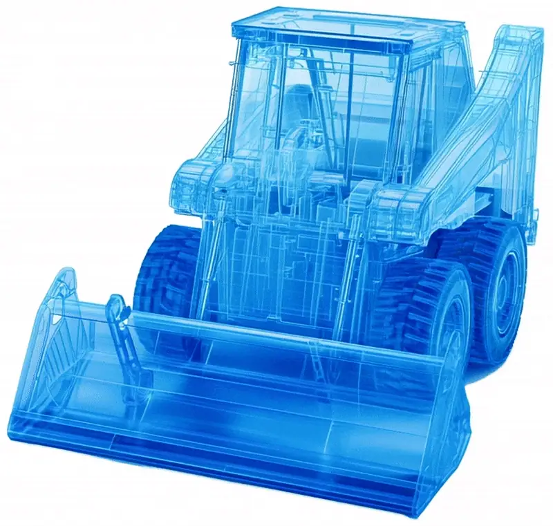
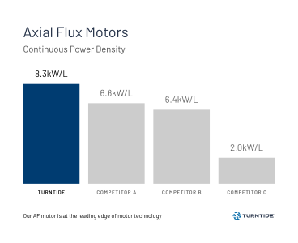
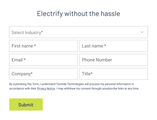
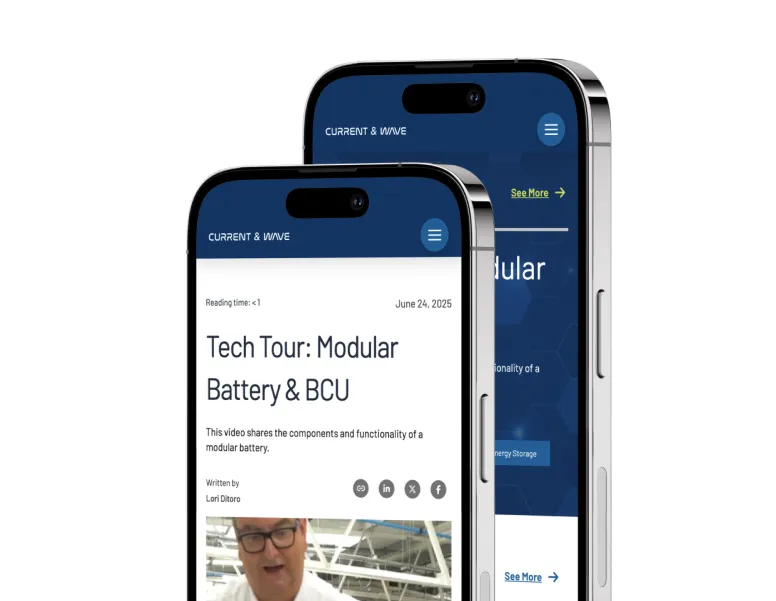
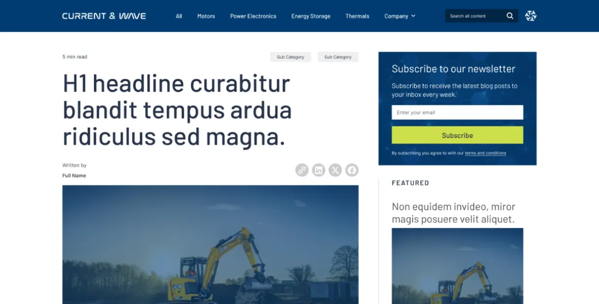
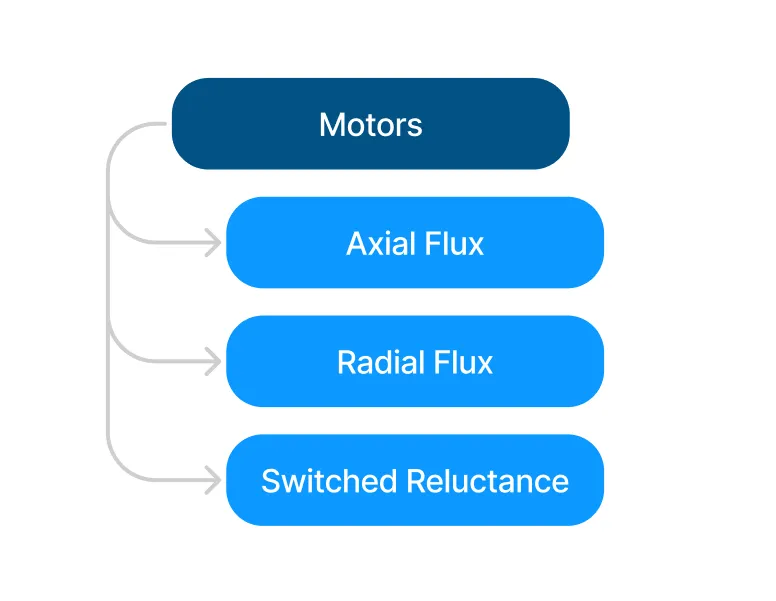

Turntide needed a digital shift that would better support sales and speak directly to their engineering customers.

## The challenge

Turntide was evolving quickly, but their website was lagging behind their new company goals and ambitions.

- Missing clear UX for product discovery
- Visuals and messaging felt outdated
- No infrastructure for automated marketing

### Our approach

Founding Creative reimagined the Turntide digital presence from the ground up for a new audience.

- Rebuild site strategy to prioritize engineers
- Implement a scalable design system
- Develop a content engine for team use

#### The process

## Repositioning an electrification brand for online B2B growth

The blueprint that turned a new website strategy into impactful outcomes, one step at a time.

01

Reposition the **brand strategy** from investor-focused to product-first

02

**UX copywriting** focused on speed, clarity, and an engineering audience

03

Create a **design system** that scales across digital presence and marketing needs

04

Develop a **custom website** using modular components tied to the new design system

05

Connect **Salesforce workflows** to user actions and lead-gen funnels across the site

06

Create **governance roles** to enable internal teams to manage content in sync

07

Strategize a **content engine** with tags, filtering, and hierarchy for enhanced SEO.

08

Design and develop 'Current and Wave' as a **sub-branded content hub** within the site

09

Implement **gated marketing content** capabilities for increased lead generation

We made the Turntide site more discoverable, usable, and effective for their actual buyers.

### The website

## Built for performance

Frictionless discovery for faster conversion.

<video src="/media/case-studies/turntide-website/video-1.mp4" autoplay muted loop playsinline preload="metadata"></video>

### Scalable UI system

Crafted a high-performance interface component collection rooted in flexibility, speed, and product engagement.

#### Customer-first strategy

Guided users through a restructured UX that prioritizes product access and reduces decision friction.

#### Engineered for performance

Flexibility and speed from buttons to fully interactive Web3D components.

#### Salesforce automation

Connected lead actions directly into Salesforce, streamlining marketing ops and improving conversion.

#### Engineered for performance

Flexibility and speed from buttons to fully interactive Web3D components.

#### The content engine

## Generating demand

Positioning brand storytelling to drive pipeline

### Site within a site

We created a standalone content hub framework under Turntide.com to enhance engagement and guide users seamlessly from search results to product discovery.

#### Fully sub-branded user experience

Branding the hub as “Current and Wave” expanded editorial freedom while staying true to the brand. Additional custom components were developed to support this new user experience.

#### Content architecture

Tagging, categorization, and hierarchy systems keep content organized and aligned with the buyer journey.

#### Gated content capture

Enabled seamless gated downloads to convert traffic into qualified leads, fueling pipeline and email list growth.

What started as a simple site refresh turned into a full transformation of how Turntide tells their story, supports their buyers, and drives growth across teams.

## A platform for conversion, content, and collaboration

### Conclusion

Founding Creative helped Turntide evolve from an investor-first story to a fully realized digital experience designed for engineers, partners, and customers alike. From redesigning the brand to building new marketing systems, we met Turntide where they were and built the tools to take them forward.

Today, their product-first website drives discovery and conversion, their internal teams own content confidently, and their brand feels aligned across every interaction. Momentum is now built into the platform itself.

### Key outcomes

-   Stronger product storytelling
    Refocused content strategy putting technical clarity front and center

-   Streamlined sales operations
    Full integration with Salesforce and governance-ready backend tools

-   Expanded marketing capabilities
    Sub-branded content engine, gated content, and campaign content

In collaboration with:

-   Client acquisition and production: [Multi Image Group](https://www.mig.cc)

## Find the right launch for your next move

Not sure if this SiteLaunch™ is the right fit? Explore our other options tailored for different goals, audiences, and growth stages.

[

Prism
SiteLaunch™

For brands ready to make an unforgettable entrance.

](/prism-sitelaunch)[

Rocket
SiteLaunch™

For growth-focused brands ready to fuel conversions.

](/rocket-sitelaunch)[

Orbit
SiteLaunch™

For scaling companies needing clarity, structure, and alignment.

](/orbit-sitelaunch)
