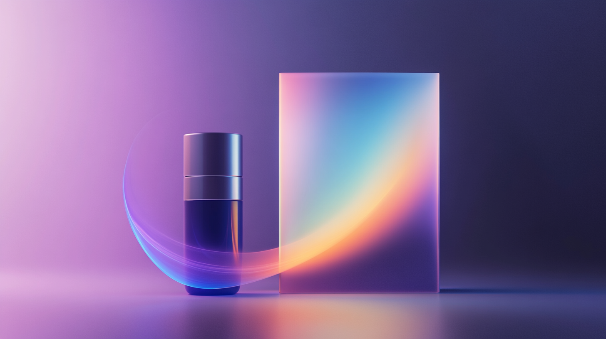
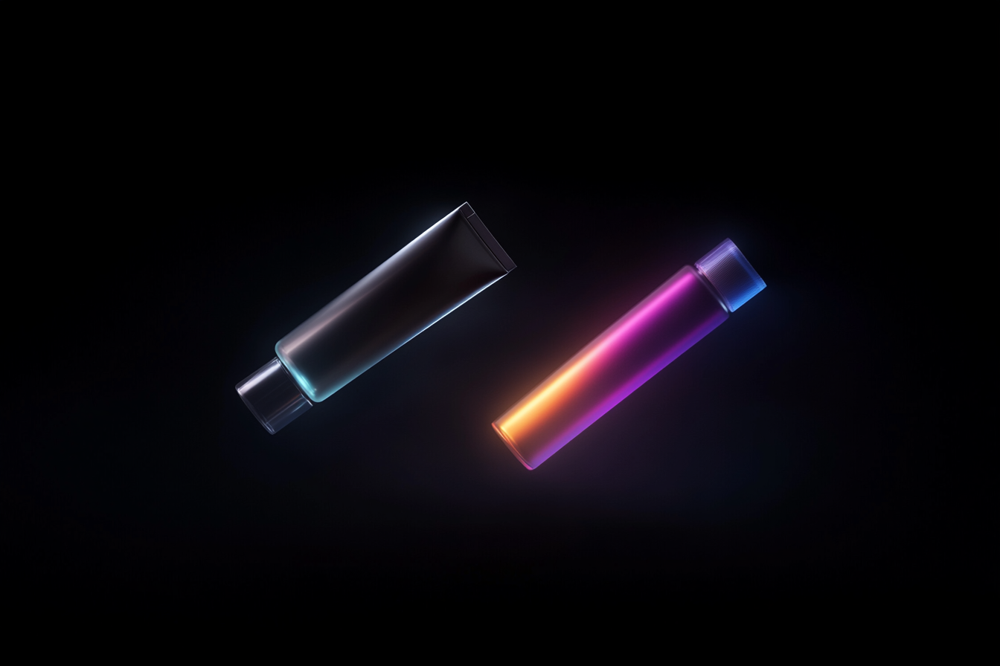
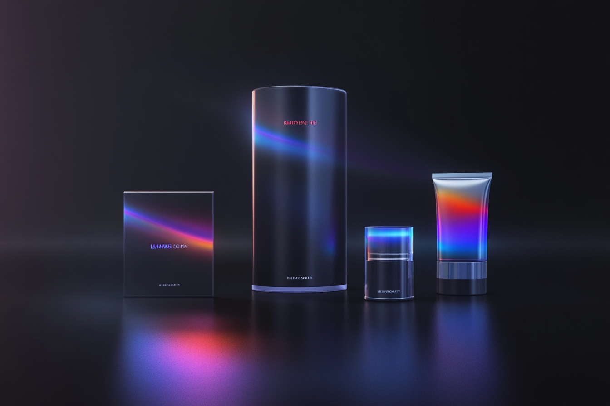

## Most beauty sites are pretty. Very few are persuasive.

If you’re applying for beauty industry marketing jobs, you’re probably well-versed in what it takes to make a product look good.

But there’s a big gap between aesthetic appeal and digital performance.

And right now, most beauty websites aren’t built for performance. They’re built from templates. Filled with flat product shots. Pinned to branding from three rebrands ago.

That’s your edge.

Because the marketers who are going to stand out in this next wave?  
They’re not just pushing promos.  
They’re upgrading the experience.

---

## Why 3D is changing the game for beauty marketers

Shoppers don’t just want to see the product anymore. They want to _feel_ it.

Interactive, animated 3D elements help bridge the digital-physical gap. They make packaging, texture, and product narratives come alive.

What that looks like in action:

-   360º animated product spins
-   Interactive ingredient breakdowns
-   Packaging reveals and ritual-based demos
-   Immersive scenes that tell a story

> These aren’t gimmicks. They’re tools for telling a brand story more clearly, and converting customers more confidently.

---

## 3D content doesn’t just impress. It performs.

Let’s talk numbers.

Marketers using 3D content on beauty websites see:

-   Longer time on page
-   Lower bounce rates
-   Higher click-through to product detail pages
-   Stronger add-to-cart rates

It works because it engages. It turns a product grid into an experience.

And when your boss (or future boss) is looking at performance metrics, you’re the one who brought the idea that actually moved the needle.

---

## How 3D makes _you_ more valuable as a marketer

When you’re applying for beauty industry marketing jobs, you’re not just selling your resume. You’re selling your potential to lead ideas that differentiate.

3D makes you look like:

-   A marketer who understands modern engagement
-   A strategist who knows how to translate brand into web
-   Someone who can make even the homepage feel like part of the brand ritual

You're not pitching a portfolio. You're presenting a vision.

---

## What Founding Creative brings to the table

We partner with beauty marketers to create:

-   Photorealistic 3D product renders
-   Interactive web experiences that elevate conversion
-   Web design systems that bring a brand to life without sacrificing performance

And we do it in a way that keeps the experience lightweight, scalable, and always on-brand.

> Because looking good isn’t enough. You need to _perform beautifully._

---

## The takeaway

If you’re gunning for your next marketing role or trying to prove your impact in the one you’ve got, show that you think in experiences, not just assets.

3D content is the upgrade button.

And your next opportunity might just be waiting for someone who knows how to click it.

---

## What’s next?

👉 Want to see how 3D web content helps beauty brands convert better, faster, and with more style? [Let’s talk.](/contact-us/)

🔗 Learn more about how Founding Creative builds show-stopping websites using [Prism Sitelaunch.](/prism-sitelaunch/)
